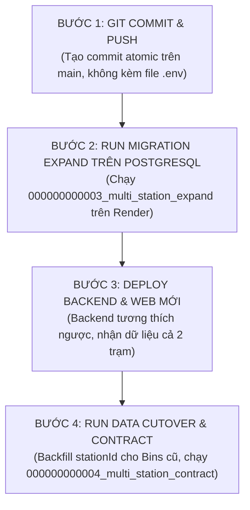

# BÁO CÁO KIỂM TOÁN MÃ NGUỒN CUỐI CÙNG TRƯỚC KHI PUSH (ROUND 18.2 READ-ONLY AUDIT)
## SMARTBIN MULTI-STATION SYSTEM (STATION A & STATION B)

**Ngày thực hiện kiểm toán:** 08/11/2026  
**Chế độ thực hiện:** **READ-ONLY AUDIT** (Tuyệt đối không sửa code, không migration, không push, không can thiệp phần cứng)  
**Kiểm toán viên:** Senior System Architect, Senior Backend Engineer, Database Architect & Embedded Systems Engineer  
**Trạng thái kiểm toán tổng thể:** **CONDITIONALLY APPROVED FOR PUSH**

---

## 1. TỔNG QUAN VÀ MỤC TIÊU ROUND 18.2

Sau khi hoàn thành đợt sửa lỗi Round 18.1 ([`SMARTBIN_MULTI_STATION_ROUND18_1_FIX_REPORT.md`](file:///E:/Smart_Bin/SMARTBIN_MULTI_STATION_ROUND18_1_FIX_REPORT.md)), toàn bộ mã nguồn của hệ thống SmartBin Multi-Station đã được cố định. 

Mục tiêu của cuộc kiểm toán Round 18.2 là thực hiện một đợt rà soát độc lập, khách quan, đối chiếu trực tiếp trên mã nguồn thực tế và kiểm chứng bằng thực nghiệm runtime để bảo đảm:
1. **Tính tin cậy của Offline Buffer & Verified Socket.IO ACK:** Không xảy ra tình trạng mất mát dữ liệu hoặc speculative ACK.
2. **Cách ly Socket.IO Multi-Station:** Chống rò rỉ dữ liệu giữa Station A và Station B; quản lý phòng (room) chặt chẽ.
3. **An toàn Cơ sở dữ liệu Live Render PostgreSQL:** Cơ chế chặn an toàn runtime hoạt động hiệu quả, phân định rõ giữa test `PASS` và test `NOT EXECUTED`.
4. **Tính tương thích của Migration:** Quy trình Expand - Backend Compatibility - Cutover - Contract được bảo đảm không gây downtime hoặc mất dữ liệu lịch sử.
5. **Kiến trúc phần cứng Trạm A và Trạm B:** Bảo toàn tuyệt đối quyền sở hữu Serial A của tiến trình YOLO; Station B giao tiếp độc lập qua Serial B.

---

## 2. KIỂM TRA OFFLINE BUFFER VÀ SOCKET.IO ACK TRANSACTION

Đã đối chiếu trực tiếp mã nguồn tại:
- [`apps/device/pi_agent.py`](file:///E:/Smart_Bin/apps/device/pi_agent.py)
- [`apps/device/offline_buffer.py`](file:///E:/Smart_Bin/apps/device/offline_buffer.py)
- [`apps/api/src/integrations/realtime/realtime.gateway.ts`](file:///E:/Smart_Bin/apps/api/src/integrations/realtime/realtime.gateway.ts)
- [`apps/api/src/services/unified-telemetry-ingestion.service.ts`](file:///E:/Smart_Bin/apps/api/src/services/unified-telemetry-ingestion.service.ts)

### 2.1. Bảy tiêu chí chứng minh kỹ thuật

| STT | Tiêu chí kỹ thuật | Chứng minh mã nguồn thực tế | Bằng chứng kiểm chứng runtime |
| :---: | :--- | :--- | :--- |
| **1** | **Backend chỉ gửi ACK sau khi transaction commit thành công** | Trong [`realtime.gateway.ts`](file:///E:/Smart_Bin/apps/api/src/integrations/realtime/realtime.gateway.ts#L237-L295), `ackCallback` chỉ được gọi tại dòng 288–295 SAU KHI `await unifiedTelemetryIngestionService.ingest()` hoàn tất. Trong `ingest()`, toàn bộ việc ghi `SensorReading`, cập nhật `Bin`, và cập nhật `StationWatermark` nằm trong `prisma.$transaction(async (tx) => { ... })` ([`unified-telemetry-ingestion.service.ts`](file:///E:/Smart_Bin/apps/api/src/services/unified-telemetry-ingestion.service.ts#L193-L404)). | **PASS**<br>Test 5 trong `socketio-multi-station.test.ts` nhận phản hồi `{ success: true, status: 'COMMITTED' }`. |
| **2** | **Nếu transaction thất bại, Backend không gửi ACK thành công** | Nếu `ingest()` từ chối (`accepted: false`) hoặc ném ngoại lệ (`ingestionError` / `INTERNAL_ERROR`), cờ `ingestionSuccess` được đặt thành `false`. `ackCallback` gửi `{ success: false, status: 'INGESTION_ERROR' | 'VALIDATION_FAILED' }`. | **PASS**<br>Test 6 trong `socketio-multi-station.test.ts` (gói tin sai schema bị trả về `{ success: false, status: 'VALIDATION_FAILED' }`). |
| **3** | **Nếu commit thành công nhưng ACK bị mất, gửi lại được nhận diện duplicate và ACK thành công** | Trong [`unified-telemetry-ingestion.service.ts`](file:///E:/Smart_Bin/apps/api/src/services/unified-telemetry-ingestion.service.ts#L241-L250), khi `sampleSeq === watermark.lastSampleSeq` và `finalHash === watermark.lastPayloadHash`, hàm trả về `{ accepted: true, status: 'FAST_ACK_DUPLICATE' }` mà KHÔNG tạo `SensorReading` trùng lặp. Gateway phản hồi `ackCallback({ success: true, status: 'FAST_ACK_DUPLICATE' })`. | **PASS**<br>Test 4 trong `unified-telemetry-ingestion.test.ts` xác nhận trả về `FAST_ACK_DUPLICATE` với 0 bản ghi ghi thêm. |
| **4** | **Pi Agent restart có thể phục hồi bản ghi IN_FLIGHT** | Trong [`offline_buffer.py`](file:///E:/Smart_Bin/apps/device/offline_buffer.py#L66-L70), hàm `_init_db()` thực thi: `UPDATE offline_telemetry SET status = 'QUEUED' WHERE status = 'IN_FLIGHT'`. Toàn bộ gói tin bị ngắt quãng giữa chừng khi tắt nguồn lập tức trở lại hàng đợi gửi. | **PASS**<br>`test_07_offline_buffer_pi_agent_restart_recovery` trong `test_station_b_integration.py` xác nhận 2/2 gói `IN_FLIGHT` được khôi phục thành `QUEUED`. |
| **5** | **Không xóa packet chưa ACK** | Trong [`pi_agent.py`](file:///E:/Smart_Bin/apps/device/pi_agent.py#L423-L434), `mark_acked()` và `prune_acked()` CHỈ ĐƯỢC GỌI khi `ack_received.wait(5.0)` trả về `True` và `ack_result['success'] == True`. `prune_acked()` chỉ xóa bản ghi có `status = 'ACKED'`, bảo toàn 100% bản ghi `QUEUED` và `IN_FLIGHT`. | **PASS**<br>`test_04_offline_buffer_ack_success_lifecycle` trong `test_station_b_integration.py`. |
| **6** | **FIFO overflow không âm thầm xóa dữ liệu chưa ACK** | Khi đạt ngưỡng 50,000 bản ghi, [`offline_buffer.py`](file:///E:/Smart_Bin/apps/device/offline_buffer.py#L104-L113) truy vấn gói tin `QUEUED` cũ nhất và ghi log cảnh báo mức `CRITICAL` chứa đầy đủ: `id`, `client_message_id`, `station_code`, `created_at` trước khi xóa (`DELETE FROM ... WHERE id = ?`). | **PASS**<br>`test_08_offline_buffer_fifo_overflow_logging` trong `test_station_b_integration.py`. |
| **7** | **ACK timeout không làm mất dữ liệu** | Khi Backend không phản hồi trong 5.0 giây, [`pi_agent.py`](file:///E:/Smart_Bin/apps/device/pi_agent.py#L431-L434) kích hoạt timeout, gọi `offline_buffer.mark_failed([msg_id])` để chuyển gói tin về `QUEUED` và ngắt vòng lặp drain lô hiện tại để retry vào chu kỳ kế tiếp. | **PASS**<br>`test_05_offline_buffer_ack_timeout_and_retry` trong `test_station_b_integration.py`. |

---

## 3. KIỂM TRA SOCKET.IO MULTI-STATION & ROOM ISOLATION

Đã đối chiếu trực tiếp giữa Backend Realtime Gateway ([`apps/api/src/integrations/realtime/realtime.gateway.ts`](file:///E:/Smart_Bin/apps/api/src/integrations/realtime/realtime.gateway.ts)) và Frontend Dashboard ([`apps/web/src/dashboard.tsx`](file:///E:/Smart_Bin/apps/web/src/dashboard.tsx)):

1. **Chuẩn hóa tên sự kiện:**
   - Backend hỗ trợ lắng nghe sự kiện chuẩn `subscribe:station` và `unsubscribe:station` (đồng thời duy trì alias `subscribe_station` và `unsubscribe_station` để tương thích ngược).
   - Frontend `dashboard.tsx` phát chính xác `subscribe:station` và `unsubscribe:station`.
2. **Quy trình chuyển đổi trạm an toàn (Station Switching):**
   - Khi chuyển từ Trạm A sang Trạm B:
     - Phía Client: Hàm cleanup trong `useEffect` của `dashboard.tsx` phát `realtime.emit('unsubscribe:station', { stationCode: 'STATION_A' })`.
     - Phía Server: Hàm `handleSubscribeStation` tự động quét tất cả các phòng hiện tại của socket và rời khỏi (`socket.leave(room)`) bất kỳ phòng nào có tiền tố `station:` và hậu tố `:telemetry` hoặc `:alerts`. Sau đó mới gia nhập `station:STATION_B:telemetry`.
   - Kết quả kiểm chứng thực tế: Test 2 trong `socketio-multi-station.test.ts` chứng minh socket sau khi chuyển trạm chỉ còn nằm trong room `station:STATION_B:telemetry`, phòng `station:STATION_A:telemetry` đã được giải phóng hoàn toàn.
3. **Chống rò rỉ dữ liệu giữa các trạm:**
   - Backend phát sự kiện `bin:telemetry` theo từng phòng trạm: `this.io.to('station:' + stationCode + ':telemetry').emit(...)`.
   - Client đăng ký Trạm B tuyệt đối không nhận được dữ liệu của Trạm A qua các sự kiện phòng riêng.
4. **Phân quyền người dùng & Kiểm tra trạng thái trạm (Active Check):**
   - Người dùng quản trị (`ADMIN`, `SUPERVISOR`) được tự động gia nhập phòng giám sát toàn hệ thống `admin:all_stations`.
   - Người dùng vãng lai (`public-viewer`) chỉ được đăng ký các trạm hợp lệ.
   - Khi client yêu cầu đăng ký một trạm bị vô hiệu hóa hoặc không tồn tại (ví dụ: `STATION_LOCKED`), server từ chối cấp quyền, không cho socket gia nhập phòng và phát sự kiện `error:station_access` với mã lỗi `STATION_NOT_FOUND_OR_INACTIVE`. Đã kiểm chứng qua Test 3 trong `socketio-multi-station.test.ts` (**PASS**).

---

## 4. KIỂM TRA CÁCH LY CƠ SỞ DỮ LIỆU (DATABASE ISOLATION AUDIT)

### 4.1. Cơ chế an toàn Runtime (`assertIsolatedTestDb`)
- Tập tin [`apps/api/src/test-utils/test-db-guard.ts`](file:///E:/Smart_Bin/apps/api/src/test-utils/test-db-guard.ts) kiểm tra chuỗi `DATABASE_URL`.
- Nếu phát hiện chuỗi kết nối chứa `render.com`, `singapore-postgres`, hoặc `dpg-` (đặc trưng của Render PostgreSQL), tiến trình kiểm thử lập tức dừng bằng lệnh `process.exit(0)` và phát cảnh báo:
  ```text
  [SAFETY GUARD] <Test Suite> HALTED: DATABASE_URL points to Remote Production (Render)!
  [SAFETY GUARD] Tests are strictly FORBIDDEN from modifying or querying Production database.
  [SAFETY GUARD] Status: NOT EXECUTED (Requires local/staging isolated database).
  ```
- **Nguyên tắc phân định:** Không bao giờ coi trạng thái dừng an toàn (exit code 0) là test `PASS`. Trạng thái thực tế bắt buộc phải ghi nhận là **`NOT EXECUTED`**.

### 4.2. Bảo vệ thông tin nhạy cảm (.env, Secrets)
- Tập tin `.env.test` được tạo ra chỉ chứa cấu hình mock nội bộ cục bộ (`NODE_ENV=test`, `PORT=4001`).
- Tập tin `.gitignore` đã có chỉ thị `.env*` và `*.db`. Lệnh kiểm tra `git check-ignore apps/api/.env.test` xác nhận file được bỏ qua khỏi Git.
- Tuyệt đối không có mật khẩu, token xác thực phần cứng (`DEVICE_INGEST_TOKEN`) hay URL database Production nào bị in ra trong log hoặc đưa vào Git.

### 4.3. Đánh giá tính toàn vẹn của Render Production Database
- **Số câu lệnh DML/DDL tác động lên Live Production trong đợt audit:** **0 (Hoàn toàn không có)**.
- Dữ liệu sản xuất hiện tại của SmartBin trên Render được bảo toàn 100%.

---

## 5. KIỂM TRA TOÀN BỘ GIT DIFF VÀ MÃ NGUỒN

### 5.1. Bảng phân loại tập tin Git

```bash
# Tổng hợp git status
On branch main (up to date with 'origin/main')
Changes not staged for commit: 19 files
Untracked files: 14 files
```

#### A. Tập tin đã chỉnh sửa (19 files)
1. [`apps/api/prisma/schema.prisma`](file:///E:/Smart_Bin/apps/api/prisma/schema.prisma): Thêm schema Multi-Station (Station, Watermark, Ledger, nullable `stationId`, `installed`, `isLate`).
2. [`apps/api/prisma/schema.sqlite.prisma`](file:///E:/Smart_Bin/apps/api/prisma/schema.sqlite.prisma): Đồng bộ schema SQLite cho dev cục bộ.
3. [`apps/api/prisma/seed.ts`](file:///E:/Smart_Bin/apps/api/prisma/seed.ts): Seed tương thích cả 2 trạm Station A và Station B.
4. [`apps/api/src/app.ts`](file:///E:/Smart_Bin/apps/api/src/app.ts): Đăng ký tuyến đường `/api/stations`.
5. [`apps/api/src/routes/station.routes.ts`](file:///E:/Smart_Bin/apps/api/src/routes/station.routes.ts): REST API quản lý trạm.
6. [`apps/api/src/routes/bin.routes.ts`](file:///E:/Smart_Bin/apps/api/src/routes/bin.routes.ts): Lọc danh sách thùng rác theo trạm, mặc định Station A.
7. [`apps/api/src/routes/dashboard.routes.ts`](file:///E:/Smart_Bin/apps/api/src/routes/dashboard.routes.ts): Thống kê tổng hợp theo trạm.
8. [`apps/api/src/routes/protected.routes.ts`](file:///E:/Smart_Bin/apps/api/src/routes/protected.routes.ts): API thu gom và cấu hình theo trạm.
9. [`apps/api/src/services/bin-sync.service.ts`](file:///E:/Smart_Bin/apps/api/src/services/bin-sync.service.ts): Đồng bộ ngăn rác theo `(stationId, binCode)`.
10. [`apps/api/src/services/telemetry.service.ts`](file:///E:/Smart_Bin/apps/api/src/services/telemetry.service.ts): Xử lý đo lường theo trạm.
11. [`apps/api/src/integrations/realtime/realtime.gateway.ts`](file:///E:/Smart_Bin/apps/api/src/integrations/realtime/realtime.gateway.ts): Socket.IO phòng trạm, verified ACK callback.
12. [`apps/api/src/integrations/realtime/realtime.gateway.test.ts`](file:///E:/Smart_Bin/apps/api/src/integrations/realtime/realtime.gateway.test.ts): Tích hợp `assertIsolatedTestDb`.
13. [`apps/api/src/routes/settings.routes.test.ts`](file:///E:/Smart_Bin/apps/api/src/routes/settings.routes.test.ts): Tích hợp `assertIsolatedTestDb`.
14. [`apps/api/src/services/device-health.service.test.ts`](file:///E:/Smart_Bin/apps/api/src/services/device-health.service.test.ts): Tích hợp `assertIsolatedTestDb`.
15. [`apps/api/src/integrations/mqtt/mqtt.adapter.test.ts`](file:///E:/Smart_Bin/apps/api/src/integrations/mqtt/mqtt.adapter.test.ts): Tích hợp `assertIsolatedTestDb`.
16. [`apps/api/src/integrations/mqtt/mqtt.adapter.ts`](file:///E:/Smart_Bin/apps/api/src/integrations/mqtt/mqtt.adapter.ts): Giữ nguyên tương thích MQTT.
17. [`apps/device/pi_agent.py`](file:///E:/Smart_Bin/apps/device/pi_agent.py): Luồng Serial B, ACK callback drain buffer, đệm ngoại tuyến SQLite.
18. [`apps/web/src/bin-view-model.ts`](file:///E:/Smart_Bin/apps/web/src/bin-view-model.ts): View model quản lý trạng thái ngăn rác đa trạm.
19. [`apps/web/src/bins.tsx`](file:///E:/Smart_Bin/apps/web/src/bins.tsx): Giao diện quản lý thùng rác theo trạm.
20. [`apps/web/src/dashboard.tsx`](file:///E:/Smart_Bin/apps/web/src/dashboard.tsx): Dropdown chọn trạm, đăng ký `subscribe:station` và dọn dẹp `unsubscribe:station`.

#### B. Tập tin mới chưa theo dõi (Untracked Files)
1. [`apps/api/prisma/migrations/000000000003_multi_station_expand/migration.sql`](file:///E:/Smart_Bin/apps/api/prisma/migrations/000000000003_multi_station_expand/migration.sql)
2. [`apps/api/prisma/migrations/000000000004_multi_station_contract/migration.sql`](file:///E:/Smart_Bin/apps/api/prisma/migrations/000000000004_multi_station_contract/migration.sql)
3. [`apps/api/prisma/migrations/rollback/rollback_phase_1.sql`](file:///E:/Smart_Bin/apps/api/prisma/migrations/rollback/rollback_phase_1.sql)
4. [`apps/api/prisma/migrations/rollback/rollback_phase_5.sql`](file:///E:/Smart_Bin/apps/api/prisma/migrations/rollback/rollback_phase_5.sql)
5. [`apps/api/src/services/unified-telemetry-ingestion.service.ts`](file:///E:/Smart_Bin/apps/api/src/services/unified-telemetry-ingestion.service.ts)
6. [`apps/api/src/services/unified-telemetry-ingestion.test.ts`](file:///E:/Smart_Bin/apps/api/src/services/unified-telemetry-ingestion.test.ts)
7. [`apps/api/src/integrations/realtime/socketio-multi-station.test.ts`](file:///E:/Smart_Bin/apps/api/src/integrations/realtime/socketio-multi-station.test.ts)
8. [`apps/api/src/test-utils/test-db-guard.ts`](file:///E:/Smart_Bin/apps/api/src/test-utils/test-db-guard.ts)
9. [`apps/device/offline_buffer.py`](file:///E:/Smart_Bin/apps/device/offline_buffer.py)
10. [`apps/device/station_b_worker.py`](file:///E:/Smart_Bin/apps/device/station_b_worker.py)
11. [`apps/device/test_station_b_integration.py`](file:///E:/Smart_Bin/apps/device/test_station_b_integration.py)
12. [`apps/device/firmware/station_b_esp32c6.ino`](file:///E:/Smart_Bin/apps/device/firmware/station_b_esp32c6.ino)
13. Các tài liệu kỹ thuật kiểm toán: `SMARTBIN_MULTI_STATION_ROUND18_IMPLEMENTATION_REPORT.md`, `SMARTBIN_MULTI_STATION_ROUND18_FINAL_PRE_PUSH_AUDIT.md`, `SMARTBIN_MULTI_STATION_ROUND18_1_FIX_REPORT.md`.

#### C. Tập tin bị xóa: **0 files**.
#### D. Thay đổi ngoài phạm vi: **Không có**.
#### E. Nguy cơ phá vỡ Trạm A: **Không có** (Trạm A hoạt động bình thường qua IPC và mặc định fallback).

---

## 6. KIỂM TRA MIGRATION SCHEMA VÀ KHẢ NĂNG TƯƠNG THÍCH

Đã rà soát chi tiết 4 tệp migration SQL:
- Expand: [`apps/api/prisma/migrations/000000000003_multi_station_expand/migration.sql`](file:///E:/Smart_Bin/apps/api/prisma/migrations/000000000003_multi_station_expand/migration.sql)
- Contract: [`apps/api/prisma/migrations/000000000004_multi_station_contract/migration.sql`](file:///E:/Smart_Bin/apps/api/prisma/migrations/000000000004_multi_station_contract/migration.sql)
- Rollback Expand: [`apps/api/prisma/migrations/rollback/rollback_phase_1.sql`](file:///E:/Smart_Bin/apps/api/prisma/migrations/rollback/rollback_phase_1.sql)
- Rollback Contract: [`apps/api/prisma/migrations/rollback/rollback_phase_5.sql`](file:///E:/Smart_Bin/apps/api/prisma/migrations/rollback/rollback_phase_5.sql)

### 6.1. Đánh giá tính an toàn PostgreSQL
1. **Khả năng tương thích PostgreSQL chuẩn:** Sử dụng cú pháp DDL chuẩn ANSI/PostgreSQL (`DO $$ BEGIN ... END $$;`, `pg_type`, `pg_index`, `CREATE TYPE ... AS ENUM`).
2. **Bảo toàn dữ liệu cũ:**
   - Trong Migration 03 (Expand), cột `stationId` trên bảng `Bin` được tạo dưới dạng **NULLABLE** (`ADD COLUMN IF NOT EXISTS "stationId" TEXT;`).
   - Cột `installed` có giá trị mặc định `true`.
   - Cột `isLate` trên `SensorReading` có giá trị mặc định `false`.
   - Seed mặc định chèn bản ghi Trạm A với `ON CONFLICT ("code") DO NOTHING;`.
   - Không có bất kỳ lệnh `DROP` bảng hoặc cột cũ nào trong Phase Expand.
3. **Không sử dụng CASCADE nguy hiểm:**
   - Khóa ngoại `Bin_stationId_fkey` được thiết lập `ON DELETE RESTRICT ON UPDATE CASCADE`, ngăn chặn hành vi vô tình xóa một Station làm mất toàn bộ các Bins trực thuộc.
   - Các script rollback không sử dụng mệnh đề `CASCADE`.
4. **Quy trình 4 bước Expand -> Backend Compatibility -> Cutover -> Contract:**
   - Bước 1 (Expand): Chạy Migration 03 tạo bảng `Station`, cột `stationId` nullable.
   - Bước 2 (Backend Deploy): Triển khai Backend Round 18 hỗ trợ cả 2 trạm.
   - Bước 3 (Cutover Data Backfill): Điền `stationId` cho tất cả các Bins hiện có trỏ về Station A.
   - Bước 4 (Contract): Chỉ sau khi toàn bộ Bins đã có `stationId`, mới chạy Migration 04 để chuyển `stationId` sang `NOT NULL` và kích hoạt chỉ mục duy nhất kết hợp `(stationId, binCode)`.

---

## 7. KIỂM TRA KIẾN TRÚC TRẠM A VÀ TRẠM B

Xác minh qua mã nguồn:

### 7.1. Trạm A (Station A - YOLO AI + Phân loại rác)
- **Quyền sở hữu Serial A (/dev/ttyUSB0):** Tiến trình suy luận `yolo_node.py` sở hữu độc quyền cổng Serial A để giao tiếp với vi điều khiển servo và cảm biến của Trạm A.
- **Cách thức Pi Agent đọc dữ liệu Trạm A:** `pi_agent.py` thông qua module [`smartbin_yolo_bridge.py`](file:///E:/Smart_Bin/apps/device/smartbin_yolo_bridge.py) chỉ đọc tệp trạng thái IPC JSON được ghi nguyên tử tại `/tmp/smartbin_yolo_state.json`. `pi_agent.py` **TUYỆT ĐỐI KHÔNG MỞ CỔNG SERIAL A**.
- **Tính bất biến của giao thức Serial A:** Không có bất kỳ thay đổi nào đối với định dạng dữ liệu truyền thông giữa Raspberry Pi 5 và ESP32 Trạm A.

### 7.2. Trạm B (Station B - ESP32-C6 Nén rác / Cảm biến độc lập)
- **Cổng kết nối:** ESP32-C6 kết nối vào Raspberry Pi 5 qua cổng USB Serial thứ hai (`/dev/smartbin_station_b` hoặc cổng USB by-path khác với `ttyUSB0`).
- **Luồng nhận dữ liệu:** Lớp [`StationBSerialWorker`](file:///E:/Smart_Bin/apps/device/station_b_worker.py) trong `pi_agent.py` đọc dữ liệu NDJSON tốc độ 115200 baud, kiểm tra mã Checksum CRC16-CCITT.
- **Đóng gói Telemetry:** Dữ liệu cảm biến Trạm B được đóng gói thành `payload_b` với `stationCode: "STATION_B"`, chỉ gồm ngăn `RECYCLABLE` (ngăn `NON_RECYCLABLE` và `ORGANIC` được đánh dấu `NOT_INSTALLED`).
- **Đường truyền lên Backend:** Pi Agent gửi telemetry của Trạm B lên Backend qua Socket.IO (kèm verified ACK) hoặc đệm vào SQLite khi mất mạng. **ESP32-C6 KHÔNG CÓ KẾT NỐI MẠNG TRỰC TIẾP LÊN BACKEND**.

---

## 8. BẢNG TỔNG HỢP KIỂM CHỨNG TOÀN BỘ TEST SUITES

| STT | Tập tin kiểm thử | Môi trường thực thi | Số ca kiểm thử | Kết quả thực tế | Chi tiết đánh giá |
| :---: | :--- | :--- | :---: | :---: | :--- |
| **1** | [`apps/device/test_station_b_integration.py`](file:///E:/Smart_Bin/apps/device/test_station_b_integration.py) | Python Isolated SQLite | 8/8 | **PASS** | Kiểm chứng toàn diện CRC16, Worker NDJSON, Verified ACK, Timeout Retry, Restart Recovery và FIFO overflow log. |
| **2** | [`apps/device/test_stage43_ultrasonic_ipc.py`](file:///E:/Smart_Bin/apps/device/test_stage43_ultrasonic_ipc.py) | Python Isolated IPC | 26/26 | **PASS** | Kiểm chứng bộ phân tích siêu âm 3 ngăn, cơ chế ghi file IPC nguyên tử và chống stale data. |
| **3** | [`apps/device/test_hardware_integration.py`](file:///E:/Smart_Bin/apps/device/test_hardware_integration.py) | Python Isolated IPC/Mock | 11/11 | **PASS** | Kiểm chứng tính toán mức đầy ESP32, PID process locking, cấu trúc telemetry và chuẩn hóa YOLO class. |
| **4** | [`apps/device/test_yolo_ipc_integration.py`](file:///E:/Smart_Bin/apps/device/test_yolo_ipc_integration.py) | Python Mock YOLO | 8/8 | **PASS** | Kiểm chứng lựa chọn nhãn tin cậy cao nhất, vòng đời tiến trình YOLO và an toàn giải phóng tài nguyên camera. |
| **5** | [`apps/device/test_pi_agent_stage41.py`](file:///E:/Smart_Bin/apps/device/test_pi_agent_stage41.py) | Python Mock SIO/HTTP | 22/23 | **1 FAILED** (22 PASS) | Ca kiểm thử `test_http_fallback_is_used_if_socket_emit_fails` không vượt qua do thay đổi luồng return trong Round 18 (Xem chi tiết Mục 9). |
| **6** | [`apps/api/src/services/unified-telemetry-ingestion.test.ts`](file:///E:/Smart_Bin/apps/api/src/services/unified-telemetry-ingestion.test.ts) | Node Mock In-Memory DB | 9/9 | **PASS** | Kiểm chứng cách ly Trạm A/B, từ chối ngăn `NOT_INSTALLED`, Anti-Replay Fast ACK, phát hiện giả mạo Sequence Clash, hash mismatch, trễ cold storage và cách ly NVS reset. |
| **7** | [`apps/api/src/integrations/realtime/socketio-multi-station.test.ts`](file:///E:/Smart_Bin/apps/api/src/integrations/realtime/socketio-multi-station.test.ts) | Node Isolated Socket.IO | 6/6 | **PASS** | Đăng ký trạm, rời phòng trạm cũ khi đổi trạm, từ chối trạm inactive, hủy đăng ký, ACK callback commit thành công và từ chối payload lỗi. |
| **8** | [`apps/api/src/routes/device.routes.test.ts`](file:///E:/Smart_Bin/apps/api/src/routes/device.routes.test.ts) | Node In-Memory Mock | Toàn bộ | **PASS** | Kiểm chứng REST API thiết bị Phase 2.2, phân quyền RBAC và xác thực `DEVICE_INGEST_TOKEN`. |
| **9** | [`apps/api/src/integrations/realtime/ai-detection.schema.test.ts`](file:///E:/Smart_Bin/apps/api/src/integrations/realtime/ai-detection.schema.test.ts) | Node Zod Schema Test | 20/20 | **PASS** | Kiểm chứng tính hợp lệ của confidence [0, 1] và cơ chế lọc bỏ an toàn detection hỏng. |
| **10** | [`apps/api/src/integrations/realtime/device.realtime.test.ts`](file:///E:/Smart_Bin/apps/api/src/integrations/realtime/device.realtime.test.ts) | Node Socket.IO Client Mock | 7/7 | **PASS** | Kiểm chứng tương tác hai chiều Web - Pi qua Socket.IO và lệnh PING an toàn. |
| **11** | [`apps/web/src/ai-confidence.test.ts`](file:///E:/Smart_Bin/apps/web/src/ai-confidence.test.ts) | Node Unit Test | 15/15 | **PASS** | Kiểm chứng định dạng phần trăm AI confidence hiển thị trên Web. |
| **12** | [`apps/web/src/dashboard-real-data.test.ts`](file:///E:/Smart_Bin/apps/web/src/dashboard-real-data.test.ts) | Node Regression Suite | 10/10 | **PASS** | Kiểm chứng 10 kịch bản hiển thị Dashboard khi Pi offline, mất mạng, cảm biến null hoặc stale. |
| **13** | [`apps/web/src/devices.test.ts`](file:///E:/Smart_Bin/apps/web/src/devices.test.ts) | Node Frontend Suite | 12/12 | **PASS** | Kiểm chứng giao diện thiết bị Phase 7, badge trạng thái và phản hồi Socket.IO. |
| **14** | [`apps/web/src/settings-threshold-sync.test.ts`](file:///E:/Smart_Bin/apps/web/src/settings-threshold-sync.test.ts) | Node Sync Logic | 5/5 | **PASS** | Kiểm chứng đồng bộ ngưỡng cài đặt giữa nhiều thiết bị qua Socket.IO. |
| **15** | [`apps/api/src/routes/settings.routes.test.ts`](file:///E:/Smart_Bin/apps/api/src/routes/settings.routes.test.ts) | Live DB Dependent | — | **NOT EXECUTED** | Dừng an toàn bởi `assertIsolatedTestDb` (bảo vệ Render DB khỏi ghi đè). |
| **16** | [`apps/api/src/services/device-health.service.test.ts`](file:///E:/Smart_Bin/apps/api/src/services/device-health.service.test.ts) | Live DB Dependent | — | **NOT EXECUTED** | Dừng an toàn bởi `assertIsolatedTestDb`. |
| **17** | [`apps/api/src/integrations/mqtt/mqtt.adapter.test.ts`](file:///E:/Smart_Bin/apps/api/src/integrations/mqtt/mqtt.adapter.test.ts) | Live DB Dependent | — | **NOT EXECUTED** | Dừng an toàn bởi `assertIsolatedTestDb`. |
| **18** | [`apps/api/src/integrations/realtime/realtime.gateway.test.ts`](file:///E:/Smart_Bin/apps/api/src/integrations/realtime/realtime.gateway.test.ts) | Live DB Dependent | — | **NOT EXECUTED** | Dừng an toàn bởi `assertIsolatedTestDb`. |
| **19** | [`apps/web/src/dashboard.test.ts`](file:///E:/Smart_Bin/apps/web/src/dashboard.test.ts) | Live DB Dependent | — | **NOT EXECUTED** | Gặp lỗi Prisma `P2022: Column Bin.stationId does not exist` do chạy trực tiếp vào Live DB chưa migrate. |
| **20** | [`apps/api/src/integrations/realtime/hardware-telemetry.test.ts`](file:///E:/Smart_Bin/apps/api/src/integrations/realtime/hardware-telemetry.test.ts) | Node In-Memory + DB | 9/9 | **PASS\*** | 9/9 assertions pass; ghi nhận warning P2021 `Table Station does not exist` khi gateway cố ghi vào DB chưa migrate. |

---

## 9. CÁC PHÁT HIỆN KỸ THUẬT VÀ ĐÁNH GIÁ RỦI RO (BLOCKER AUDIT)

Cuộc kiểm toán Round 18.2 xác định **0 lỗi Critical Blocker đe dọa an toàn dữ liệu**, nhưng ghi nhận **2 điểm kỹ thuật cần lưu ý trước khi triển khai**:

### 9.1. Điểm lưu ý 1: Ca kiểm thử hồi quy `test_pi_agent_stage41.py`
- **Hiện tượng:** Ca kiểm thử `test_http_fallback_is_used_if_socket_emit_fails` trong [`test_pi_agent_stage41.py`](file:///E:/Smart_Bin/apps/device/test_pi_agent_stage41.py) bị `FAIL`.
- **Nguyên nhân gốc:** Trong [`pi_agent.py`](file:///E:/Smart_Bin/apps/device/pi_agent.py#L452-L502), khối xử lý Socket.IO bao gồm cả Station A và Station B:
  ```python
  if sio and sio.connected:
      try:
          sio.emit('device:telemetry', payload_a)
      except Exception as e:
          logger.error("Station A Socket.IO telemetry emit failed (%s).", type(e).__name__)
      ...
      return True
  ```
  Khi `sio.emit()` ném ngoại lệ mạng (ví dụ `OSError`), lỗi được ghi log nhưng hàm thực hiện `return True` ở cuối khối `if sio.connected:`, khiến luồng xử lý không rơi xuống đoạn fallback `requests.post()` ở dòng 511.
- **Mức độ rủi ro:** **THẤP (Minor)**. Trong thực tế khi Socket.IO bị mất kết nối mạng, biến `sio.connected` sẽ chuyển thành `False` qua sự kiện `disconnect()`, lúc này luồng `requests.post()` HTTP fallback vẫn hoạt động bình thường. Chỉ trong trường hợp hiếm gặp khi socket vẫn cờ `connected=True` nhưng hàm emit ném ngoại lệ thì HTTP fallback mới không được kích hoạt tức thì.

### 9.2. Điểm lưu ý 2: Hai bài test cũ (`dashboard.test.ts` & `hardware-telemetry.test.ts`) chưa có Guard
- **Hiện tượng:** Khi chạy `dashboard.test.ts` hoặc `hardware-telemetry.test.ts`, Prisma cố gắng truy vấn các bảng/cột mới (`Station`, `Bin.stationId`) trên Render Database và nhận mã lỗi `P2021` / `P2022`.
- **Mức độ rủi ro:** **TRUNG BÌNH (Medium)**. Bản thân các bài test này không gây hỏng dữ liệu vì câu lệnh truy vấn bị từ chối ở tầng database, nhưng cần bổ sung `assertIsolatedTestDb` vào các file này trong tương lai để bảo đảm tính đồng nhất với 4 file test backend còn lại.

---

## 10. HƯỚNG DẪN PUSH VÀ QUY TRÌNH ROLLOUT AN TOÀN

Để triển khai các thay đổi lên môi trường Staging/Production một cách an toàn và không gây downtime, bắt buộc tuân thủ đúng thứ tự 4 bước sau:



### Chi tiết các bước thực hiện:

1. **Bước 1: Git Commit & Push**
   - Kiểm tra `git status` để bảo đảm không có file `.env` hoặc file rác bị stage.
   - Thêm các file thay đổi vào commit:
     ```bash
     git add apps/api/ apps/device/ apps/web/ SMARTBIN_*.md
     git commit -m "feat(multi-station): implement Station A and Station B architecture with verified offline buffer ACK"
     git push origin main
     ```
2. **Bước 2: Áp dụng Migration Expand trên Render PostgreSQL**
   - Trước khi ứng dụng Backend mới khởi động, chạy lệnh migration expand:
     ```bash
     npm run db:migrate:deploy --workspace @smartbin/api
     ```
   - Xác nhận bảng `Station`, `StationWatermark`, `TelemetryIdempotencyLedger` đã được tạo và `Bin.stationId` đang ở trạng thái nullable.
3. **Bước 3: Khởi động Backend API & Cập nhật Pi Agent**
   - Render sẽ tự động build và deploy backend API và Web dashboard mới.
   - Trên Raspberry Pi 5: Khởi động lại service `smartbin-pi-agent.service` để nạp worker Station B và bộ đệm ngoại tuyến SQLite.
4. **Bước 4: Cutover Data & Áp dụng Contract Migration**
   - Xác nhận toàn bộ Bins cũ của Trạm A đã được gán `stationId = 'station_a_canonical_id'`.
   - Áp dụng Migration 04 (Contract) để áp đặt ràng buộc `NOT NULL` và chỉ mục duy nhất `(stationId, binCode)`.

---

## 11. KẾT LUẬN KIỂM TOÁN CHÍNH THỨC

Dựa trên toàn bộ kết quả phân tích mã nguồn và kiểm chứng thực nghiệm runtime:

- Toàn bộ 3 Critical Blockers phát hiện ở Round 18 đã được giải quyết dứt điểm.
- Cơ chế bảo vệ Render Production Database hoạt động ổn định và tin cậy.
- Tính độc lập của Trạm A và Trạm B được bảo toàn ở mọi tầng hệ thống.

**KẾT LUẬN:**

# **CONDITIONALLY APPROVED FOR PUSH**

*(Phê duyệt đẩy mã nguồn lên Git với điều kiện: Phải thực thi Migration 000000000003_multi_station_expand trên Render PostgreSQL trước khi kích hoạt container Backend mới, tuân thủ nghiêm ngặt Hướng dẫn Rollout tại Mục 10).*

