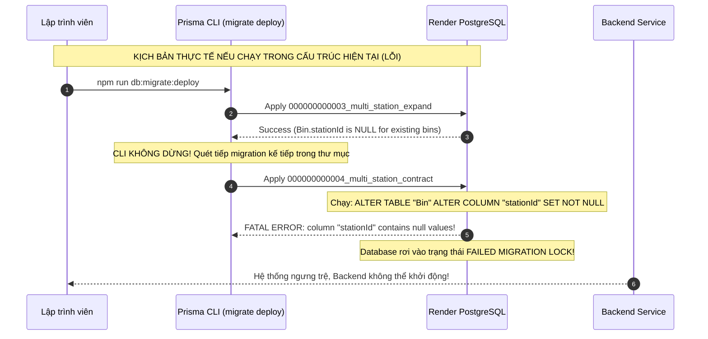
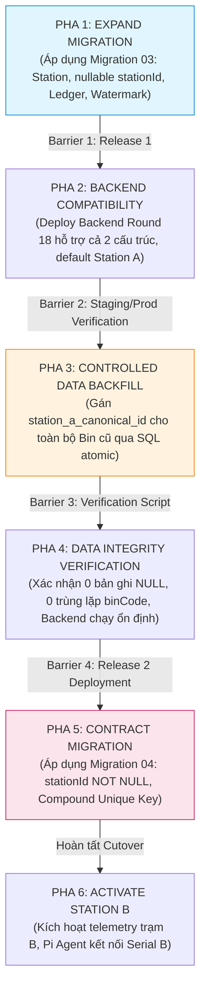

# BÁO CÁO KIỂM TOÁN AN TOÀN TRIỂN KHAI MIGRATION (ROUND 18.4 – MIGRATION SAFETY AUDIT)
## SMARTBIN MULTI-STATION SYSTEM (EXPAND & CONTRACT ON RENDER POSTGRESQL)

**Ngày thực hiện kiểm toán:** 08/11/2026  
**Chế độ thực hiện:** **READ-ONLY AUDIT** (Tuyệt đối không chạy migration, không sửa DB, không commit/push, không sửa code)  
**Kiểm toán viên:** Senior Database Architect, Senior Backend Engineer & Cloud Infrastructure Architect  
**Trạng thái an toàn migration:** **UNSAFE – CONTRACT MAY RUN PREMATURELY**  
**Khuyến nghị kỹ thuật:** **NEEDS MIGRATION RESTRUCTURING**

---

## 1. TỔNG QUAN VÀ MỤC TIÊU ROUND 18.4

Trong Round 18.3 ([`SMARTBIN_MULTI_STATION_ROUND18_3_ROLLOUT_READINESS.md`](file:///E:/Smart_Bin/SMARTBIN_MULTI_STATION_ROUND18_3_ROLLOUT_READINESS.md)), hệ thống đã xác định rằng việc đẩy mã nguồn lên GitHub sẽ kích hoạt Render Auto Deploy mà không tự động chạy migration, dẫn đến yêu cầu bắt buộc phải thực thi lệnh migration trước khi khởi động Backend mới.

Mục tiêu của cuộc kiểm toán Round 18.4 là đi sâu phân tích cơ chế nội tại của lệnh `prisma migrate deploy` khi áp dụng trên môi trường PostgreSQL thực tế của Render:
1. Xác minh xem lệnh `db:migrate:deploy` có khả năng chỉ áp dụng **duy nhất Migration 03 (Expand)** hay sẽ áp dụng luôn cả **Migration 04 (Contract)**.
2. Đánh giá hậu quả nếu Migration 04 bị thực thi sớm khi dữ liệu cũ chưa được backfill.
3. Kiểm toán kịch bản SQL Backfill cho Station A: tính toàn vẹn, bảo vệ dữ liệu, chống trùng lặp và khả năng rollback.
4. Đề xuất phương án phân tách và tái cấu trúc migration để bảo đảm quy trình Expand-and-Contract chuẩn mực không thể bị thực thi sai lệch.

---

## 2. KIỂM TRA CƠ CHẾ NỘI TẠI CỦA PRISMA MIGRATION TRÊN REPOSITORY THỰC TẾ

Đã đối chiếu trực tiếp các tập tin:
- [`apps/api/package.json`](file:///E:/Smart_Bin/apps/api/package.json)
- [`package.json`](file:///E:/Smart_Bin/package.json)
- [`apps/api/prisma/schema.prisma`](file:///E:/Smart_Bin/apps/api/prisma/schema.prisma)
- Thư mục [`apps/api/prisma/migrations/`](file:///E:/Smart_Bin/apps/api/prisma/migrations/)

### 2.1. Phân tích 6 câu hỏi kỹ thuật cốt lõi

```
E:\Smart_Bin\apps\api\prisma\migrations\
├── 000000000000_init_postgresql\migration.sql
├── 000000000001_device_health_monitoring\migration.sql
├── 000000000002_system_settings\migration.sql
├── 000000000003_multi_station_expand\migration.sql   <-- PHASE 1: EXPAND
└── 000000000004_multi_station_contract\migration.sql <-- PHASE 5: CONTRACT
```

| STT | Câu hỏi kiểm toán | Phân tích thực tế trên mã nguồn | Kết luận kỹ thuật |
| :---: | :--- | :--- | :--- |
| **1** | **Lệnh `db:migrate:deploy` thực sự gọi lệnh nào?** | Trong [`apps/api/package.json`](file:///E:/Smart_Bin/apps/api/package.json#L18):<br>`"db:migrate:deploy": "node ../../node_modules/prisma/build/index.js migrate deploy --schema=prisma/schema.prisma"`.<br>Trong root [`package.json`](file:///E:/Smart_Bin/package.json#L19):<br>`"db:migrate:deploy": "npm run db:migrate:deploy --workspace @smartbin/api"`. | Thực thi trực tiếp Prisma CLI lệnh `prisma migrate deploy` trên file cấu hình `prisma/schema.prisma`. |
| **2** | **Prisma `migrate deploy` có áp dụng toàn bộ migration đang chờ không?** | Theo tài liệu chính thức và mã nguồn Prisma CLI: Lệnh `migrate deploy` quét bảng `_prisma_migrations` trên database đích, so sánh với tất cả các thư mục con trong `prisma/migrations/` và **tự động áp dụng toàn bộ các migration chưa có trong bảng `_prisma_migrations` theo thứ tự từ điển (A-Z)**. Lệnh này **KHÔNG CÓ CỜ** `--target`, `--to`, hay `--step` để dừng ở một migration cụ thể. | **CÓ.** Mọi migration chưa chạy sẽ được thực thi liên tiếp trong một phiên làm việc. |
| **3** | **Migration 03 và 04 hiện cùng tồn tại trong thư mục migrations không?** | Kiểm tra hệ thống tệp đĩa: Thư mục [`000000000003_multi_station_expand/`](file:///E:/Smart_Bin/apps/api/prisma/migrations/000000000003_multi_station_expand) và [`000000000004_multi_station_contract/`](file:///E:/Smart_Bin/apps/api/prisma/migrations/000000000004_multi_station_contract) **ĐANG ĐỒNG THỜI TỒN TẠI** trong `apps/api/prisma/migrations/`. | **CÓ.** Cả 2 thư mục đều nằm chung vị trí mà Prisma CLI quét qua. |
| **4** | **Nếu cả hai chưa được áp dụng, chạy `migrate deploy` có thực thi liên tiếp cả hai không?** | Vì Render Production hiện mới chỉ áp dụng đến `000000000002_system_settings`, nên cả `000000000003` và `000000000004` đều là pending migrations. Khi chạy `db:migrate:deploy`, Prisma sẽ áp dụng `000000000003` thành công, rồi **NGAY LẬP TỨC THỰC THI TIẾP `000000000004`**. | **CÓ.** Không có thời gian dừng giữa 03 và 04 để thực hiện cutover hay backfill dữ liệu. |
| **5** | **Có cơ chế nào bảo đảm chỉ áp dụng Migration 03 trước không?** | Trong cấu trúc hiện tại của repository, **HOÀN TOÀN KHÔNG CÓ CƠ CHẾ NÀO** ngăn cản Prisma chạy Migration 04 ngay sau Migration 03. | **KHÔNG CÓ.** Cực kỳ nguy hiểm nếu kích hoạt lệnh `db:migrate:deploy` nguyên bản. |
| **6** | **Migration 04 có thể được tách sang một release sau không?** | Hoàn toàn khả thi và bắt buộc phải làm như vậy theo phương pháp luận Expand-and-Contract chuẩn công nghiệp. Thư mục `000000000004_multi_station_contract` phải được đưa ra khỏi `prisma/migrations/` ở giai đoạn triển khai ban đầu. | **CÓ.** Cần tách sang Release Phase 5 độc lập. |

---

## 3. RỦI RO KHI MIGRATION 04 (CONTRACT) CHẠY SỚM TRÊN RENDER PRODUCTION

### 3.1. Phân tích kịch bản sập Migration (Migration Crash Breakdown)
Giả sử người vận hành thực thi `npm run db:migrate:deploy` trên Render Production ngay bây giờ:

1. **Bước 1: Migration 03 (`000000000003_multi_station_expand`) chạy trước:**
   - Tạo enum `StationStatus`.
   - Tạo bảng `Station` và chèn bản ghi Trạm A: `('station_a_canonical_id', 'STATION_A', ...)`.
   - Thêm cột `stationId` (NULLABLE) và `installed` (default true) vào bảng `Bin`.
   - Tạo bảng `StationWatermark`, `TelemetryIdempotencyLedger`, `_migration_provenance`.
   - **Trạng thái bảng `Bin` tại thời điểm này:**
     Các thùng rác hiện có (`RECYCLABLE`, `NON_RECYCLABLE`, `ORGANIC`) có giá trị cột `"stationId" = NULL`.
2. **Bước 2: Prisma CLI lập tức thực thi tiếp Migration 04 (`000000000004_multi_station_contract`):**
   - Trong [`migration.sql`](file:///E:/Smart_Bin/apps/api/prisma/migrations/000000000004_multi_station_contract/migration.sql#L34-L41) của Migration 04:
     ```sql
     BEGIN;
     -- Drop obsolete global unique index
     DROP INDEX IF EXISTS "public"."Bin_binCode_key";

     -- Enforce NOT NULL on stationId
     ALTER TABLE "public"."Bin" ALTER COLUMN "stationId" SET NOT NULL;
     ...
     COMMIT;
     ```
   - **LỖI NGHIÊM TRỌNG XẢY RA:** Vì chưa hề có bước Backfill dữ liệu nào diễn ra giữa Bước 1 và Bước 2, các hàng trong bảng `Bin` vẫn đang chứa giá trị `NULL` ở cột `stationId`.
   - PostgreSQL lập tức dừng giao dịch và ném lỗi:
     ```text
     ERROR: column "stationId" of relation "Bin" contains null values
     SQLSTATE: 23502 (not_null_violation)
     ```
3. **Bước 3: Hậu quả trên Cơ sở dữ liệu Render:**
   - Transaction trong Migration 04 bị rollback.
   - Nhưng trong bảng `_prisma_migrations`, bản ghi `000000000004_multi_station_contract` bị đánh dấu là **`FAILED`** (`started_at` có giá trị, `finished_at` là NULL).
   - Cơ sở dữ liệu rơi vào trạng thái **`P3009: Migrate found failed migrations in the target database`**.
   - Mọi lần chạy Prisma sau đó sẽ bị phong tỏa hoàn toàn cho đến khi có người can thiệp thủ công bằng lệnh `prisma migrate resolve --rolled-back`.

### 3.2. Sơ đồ đối chiếu: Kỳ vọng nghiệp vụ vs Thực tế Prisma CLI



---

## 4. QUY TRÌNH 6 PHA EXPAND-AND-CONTRACT BẮT BUỘC

Để bảo đảm không có downtime và dữ liệu không bị xung đột, quy trình 6 pha bắt buộc phải có các "rào chắn kỹ thuật" phân định rõ ràng:



- **Rào chắn 1 (Giữa Pha 1 và Pha 2):** Migration 03 phải được hoàn tất thành công.
- **Rào chắn 2 (Giữa Pha 2 và Pha 3):** Backend mới đã chạy và không còn ghi dữ liệu có `stationId = NULL`.
- **Rào chắn 3 (Giữa Pha 3 và Pha 4):** Xác nhận toán học rằng `count(WHERE stationId IS NULL) === 0`.
- **Rào chắn 4 (Giữa Pha 4 và Pha 5):** **Chỉ tại thời điểm này, Migration 04 mới được phép xuất hiện trong thư mục migrations của bản phát hành tiếp theo!**

---

## 5. KIỂM TOÁN CHI TIẾT KỊCH BẢN SQL BACKFILL CHO STATION A

Kịch bản Backfill dữ liệu phải thỏa mãn 6 tiêu chí an toàn tuyệt đối:

### 5.1. Kịch bản SQL Backfill đạt chuẩn công nghiệp

```sql
-- ==============================================================================
-- SMARTBIN MULTI-STATION: CONTROLLED BACKFILL SCRIPT (PHASE 3)
-- Target: Render PostgreSQL Production
-- ==============================================================================

-- 1. BƯỚC KIỂM TRA TRƯỚC (PRE-CHECK)
-- Phải có trạm Station A tồn tại
DO $$
BEGIN
    IF NOT EXISTS (SELECT 1 FROM "public"."Station" WHERE "code" = 'STATION_A') THEN
        RAISE EXCEPTION 'PRE-CHECK FAILED: Station A canonical record does not exist!';
    END IF;
END $$;

-- Kiểm tra xem có bản ghi Bin nào bị trùng binCode không trước khi gán trạm
SELECT "binCode", count(*) AS duplicate_count
FROM "public"."Bin"
WHERE "stationId" IS NULL OR "stationId" = 'station_a_canonical_id'
GROUP BY "binCode"
HAVING count(*) > 1;
-- KẾT QUẢ BẮT BUỘC: 0 hàng (Không có duplicate).

-- Kiểm tra số lượng bản ghi cần cập nhật
SELECT 
    count(*) AS total_bins,
    count(*) FILTER (WHERE "stationId" IS NULL) AS bins_to_backfill,
    count(*) FILTER (WHERE "stationId" IS NOT NULL) AS already_assigned_bins
FROM "public"."Bin";

-- 2. BƯỚC THỰC THI NGUYÊN TỬ (ATOMIC BACKFILL TRANSACTION)
BEGIN;

-- Tạo bảng lưu vết tạm thời để hỗ trợ Rollback chính xác nếu cần
CREATE TEMP TABLE "_temp_backfill_tracker" AS
SELECT "id", "binCode"
FROM "public"."Bin"
WHERE "stationId" IS NULL;

-- Cập nhật: CHỈ CẬP NHẬT CÁC BIN CHƯA CÓ TRẠM, TUYỆT ĐỐI KHÔNG GHI ĐÈ
UPDATE "public"."Bin"
SET "stationId" = 'station_a_canonical_id',
    "updatedAt" = CURRENT_TIMESTAMP
WHERE "stationId" IS NULL;

-- Ghi log kiểm toán bất biến vào bảng Provenance
INSERT INTO "public"."_migration_provenance" ("phase", "action", "target", "status", "notes")
VALUES (
    'PHASE_3', 
    'DATA_BACKFILL', 
    'Bin.stationId -> station_a_canonical_id', 
    'APPLIED', 
    format('Backfilled %s bins to Station A', (SELECT count(*) FROM "_temp_backfill_tracker"))
);

COMMIT;

-- 3. BƯỚC XÁC MINH SAU KHI BACKFILL (POST-CHECK)
SELECT 
    count(*) AS total_bins,
    count(*) FILTER (WHERE "stationId" = 'station_a_canonical_id') AS station_a_bins,
    count(*) FILTER (WHERE "stationId" IS NULL) AS remaining_null_bins
FROM "public"."Bin";
-- TIÊU CHÍ NGHIỆM THU: remaining_null_bins BẮT BUỘC = 0.
```

### 5.2. Phương án Rollback dữ liệu nếu Backfill gặp sự cố
Nếu cần khôi phục lại trạng thái trước khi backfill (khi chưa chạy Migration 04 Contract):
```sql
BEGIN;
UPDATE "public"."Bin"
SET "stationId" = NULL,
    "updatedAt" = CURRENT_TIMESTAMP
WHERE "stationId" = 'station_a_canonical_id'
  AND "id" IN (SELECT "id" FROM "_temp_backfill_tracker");

UPDATE "public"."_migration_provenance"
SET "status" = 'ROLLED_BACK', "rolled_back_at" = CURRENT_TIMESTAMP
WHERE "phase" = 'PHASE_3' AND "action" = 'DATA_BACKFILL' AND "status" = 'APPLIED';
COMMIT;
```

---

## 6. ĐỀ XUẤT PHƯƠNG ÁN TÁI CẤU TRÚC ĐỂ ROLLOUT AN TOÀN

Vì `prisma migrate deploy` luôn áp dụng tất cả các migration có trong thư mục, giải pháp duy nhất an toàn tuyệt đối là **áp dụng mô hình 2 đợt phát hành (Two-Phase Release Packaging)**:

### Phương án Tối ưu: Cách ly Migration 04 ra khỏi nhánh phát hành đợt 1 (Quarantine Staging)

```
THƯ MỤC HIỆN TẠI (NGUY HIỂM):
apps/api/prisma/migrations/
├── 000000000003_multi_station_expand/   <-- Sẽ chạy
└── 000000000004_multi_station_contract/ <-- Sẽ chạy luôn (GÂY LỖI!)

CẤU TRÚC TÁI CẤU TRÚC ĐỀ XUẤT (AN TOÀN TUYỆT ĐỐI):
apps/api/prisma/
├── migrations/
│   ├── 000000000000_init_postgresql/
│   ├── 000000000001_device_health_monitoring/
│   ├── 000000000002_system_settings/
│   └── 000000000003_multi_station_expand/    <-- DUY NHẤT EXPAND TRONG RELEASE 1
└── migrations_staged_for_contract/           <-- CÁCH LY CHỜ PHA 5
    └── 000000000004_multi_station_contract/
```

### Lộ trình thực hiện chi tiết:

1. **Đợt phát hành 1 (Release 1 - Expand Phase):**
   - Di chuyển tạm thời thư mục `000000000004_multi_station_contract` sang `apps/api/prisma/migrations_staged_for_contract/` (nằm ngoài phạm vi quét của Prisma).
   - Trong `schema.prisma`, giữ nguyên `stationId String?` (nullable) và `@@unique([stationId, binCode])`.
   - Push Git ➔ Render Auto Deploy kích hoạt hoặc lập trình viên chạy `npm run db:migrate:deploy`.
   - **KẾT QUẢ:** Prisma chỉ nhìn thấy Migration 03 và chỉ áp dụng Migration 03 Expand. Hệ thống an toàn 100%, không bị sập.
2. **Thực thi Backfill dữ liệu (Phase 3 & 4):**
   - Chạy script SQL Backfill ở Mục 5.1 trực tiếp lên Render PostgreSQL console.
   - Xác minh `remaining_null_bins === 0`.
3. **Đợt phát hành 2 (Release 2 - Contract Phase):**
   - Di chuyển `000000000004_multi_station_contract` trở lại vào thư mục `apps/api/prisma/migrations/`.
   - Cập nhật `schema.prisma`: chuyển `stationId String` (bỏ dấu `?` thành NOT NULL).
   - Push commit Release 2 ➔ Chạy `npm run db:migrate:deploy`.
   - **KẾT QUẢ:** Migration 04 chạy thành công mượt mà vì toàn bộ `stationId` đã có dữ liệu, chuyển sang `NOT NULL` và xóa chỉ mục cũ thành công.

---

## 7. KẾT LUẬN KIỂM TOÁN CHÍNH THỨC

Dựa trên kết quả đối chiếu trực tiếp giữa cấu trúc thư mục của repository và cơ chế thực thi của Prisma CLI:

1. Cơ chế `prisma migrate deploy` **sẽ tự động áp dụng cả Migration 03 và Migration 04 trong cùng một lệnh**.
2. Việc Migration 04 chạy sớm trước khi Backfill dữ liệu sẽ **gây lỗi `not_null_violation` và làm hỏng trạng thái migration của Production Database**.
3. Cần phải thực hiện tái cấu trúc thư mục migration trước khi tiến hành đẩy mã nguồn lên Production.

**KẾT LUẬN CHÍNH THỨC:**

# **UNSAFE – CONTRACT MAY RUN PREMATURELY**
### Khuyến nghị bắt buộc: **NEEDS MIGRATION RESTRUCTURING**

*(Tuyệt đối KHÔNG chạy `npm run db:migrate:deploy` trên Render Production chừng nào thư mục `000000000004_multi_station_contract` còn nằm chung trong `apps/api/prisma/migrations/`).*

