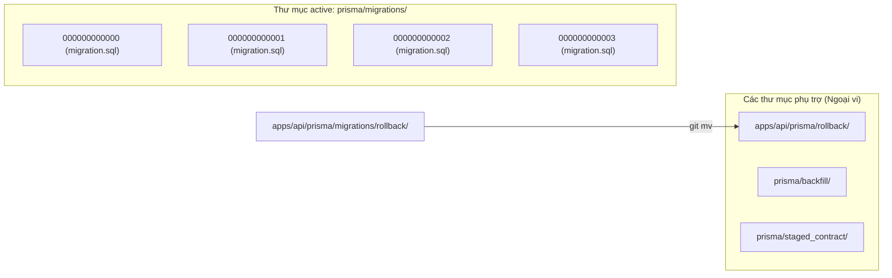

# BÁO CÁO ĐIỀU TRA SỰ CỐ ĐÓNG GÓI PRISMA P3015 (ROUND 18.9)
## SMARTBIN MULTI-STATION SYSTEM: PRISMA P3015 PACKAGING INCIDENT REPORT

**Ngày thực hiện:** 08/11/2026  
**Chế độ thực hiện:** **READ-ONLY AUDIT TUYỆT ĐỐI**  
*(Không sửa file, không tạo/xóa migration, không chạy migrate deploy, không chạy SQL Production, không push Git, không deploy, không in secret)*  
**Commit điều tra:** `d991f4887c8f76f64335147a9bc9ea326b894393` *(Author: Anh Quan, Date: Sun Nov 8 20:30:00 2026 +0700 - "Thiet lap Tram A va B")*  
**Lỗi ghi nhận:** `Prisma P3015 – Could not find the migration file at migration.sql`  

---

## 1. TÓM TẮT NGUYÊN NHÂN GỐC (EXECUTIVE SUMMARY & ROOT CAUSE)

```
apps/api/prisma/migrations/
├── 000000000000_init_postgresql/         ──> migration.sql (HỢP LỆ)
├── 000000000001_device_health_monitoring/ ──> migration.sql (HỢP LỆ)
├── 000000000002_system_settings/          ──> migration.sql (HỢP LỆ)
├── 000000000003_multi_station_expand/     ──> migration.sql (HỢP LỆ, 4,161 bytes)
└── rollback/                              ──> rollback_phase_1.sql, rollback_phase_5.sql
                                                [THIẾU migration.sql -> GÂY LỖI P3015!]
```

### Nguyên nhân gốc (Root Cause)
1. **Migration 03 (`000000000003_multi_station_expand`) KHÔNG HỀ BỊ THIẾU `migration.sql`:**
   File [`apps/api/prisma/migrations/000000000003_multi_station_expand/migration.sql`](file:///E:/Smart_Bin/apps/api/prisma/migrations/000000000003_multi_station_expand/migration.sql) tồn tại nguyên vẹn trên working tree (4,161 bytes, 96 dòng DDL), được Git theo dõi đầy đủ và có mặt chính xác trong commit `d991f4887c8f76f64335147a9bc9ea326b894393`.
2. **Thư mục thực sự gây ra lỗi là `apps/api/prisma/migrations/rollback/`:**
   - Trong quá trình chuẩn bị kịch bản hoàn tác (Round 18.2/18.4), thư mục `rollback/` đã được đặt trực tiếp bên trong `apps/api/prisma/migrations/`.
   - **Đặc tính cơ chế của Prisma Migrate Engine:** Prisma tự động quét và coi **mọi thư mục con** nằm bên trong `prisma/migrations/` là một migration package.
   - Do đó, Prisma phát hiện **5 migrations** thay vì 4:
     `000000000000_init_postgresql`, `000000000001_device_health_monitoring`, `000000000002_system_settings`, `000000000003_multi_station_expand`, và **`rollback`**.
   - Đối với mỗi thư mục migration, Prisma bắt buộc phải tìm thấy file có tên cố định là `migration.sql`.
   - Bên trong `rollback/` chỉ có 2 file: `rollback_phase_1.sql` và `rollback_phase_5.sql`, **hoàn toàn không có file `migration.sql`**.
   - Khi lệnh `prisma migrate deploy` hoặc kiểm tra migration được kích hoạt trong quy trình build/deploy trên Render, Prisma Engine cố gắng đọc `prisma/migrations/rollback/migration.sql` và lập tức ném mã lỗi:  
     **`Error: P3015: Could not find the migration file at migration.sql`** (chỉ định thư mục migration `rollback`).

---

## 2. KẾT QUẢ KIỂM TRA CHI TIẾT 6 NỘI DUNG

### 2.1. Kiểm tra thư mục `apps/api/prisma/migrations/000000000003_multi_station_expand/`
- **Trạng thái trên ổ đĩa:** Thư mục tồn tại tại [`apps/api/prisma/migrations/000000000003_multi_station_expand/`](file:///E:/Smart_Bin/apps/api/prisma/migrations/000000000003_multi_station_expand/).
- **Nội dung bên trong:** Duy nhất 1 file `migration.sql` với kích thước 4,161 bytes, mã băm SHA-256: `B6F27524E0D6C2410D750ACFACAE2C12461C3C41F765F58058A3783C6BAD1FC1`.
- **Kết luận:** Thư mục Migration 03 hoàn toàn bình thường và hợp lệ.

### 2.2. Xác nhận file `migration.sql` của Migration 03
- **Tồn tại trên working tree:** **CÓ** (Kích thước: 4,161 bytes).
- **Được Git track:** **CÓ** (Blob SHA: `9e70a92e285867418f12a1953c992c90dbc80345`, Mode: `100644`).
- **Tồn tại trong commit `d991f4887c8f76f64335147a9bc9ea326b894393`:** **CÓ**.
  - Kiểm tra lệnh: `git cat-file -e d991f48:apps/api/prisma/migrations/000000000003_multi_station_expand/migration.sql` trả về exit code `0`.
- **Bị `.gitignore` hoặc `.git/info/exclude` bỏ qua:** **KHÔNG**.
  - Lệnh `git check-ignore -v` trả về exit code `1` (file không bị ignore).

### 2.3. Rà soát toàn bộ thư mục `apps/api/prisma/migrations/`
Liệt kê tất cả 5 thư mục con hiện diện và đối soát file `migration.sql`:

| Tên thư mục | File tồn tại bên trong | Có `migration.sql` không? | Đánh giá tính hợp lệ của Prisma |
| :--- | :--- | :---: | :--- |
| `000000000000_init_postgresql` | `migration.sql` (7,657 bytes) | **CÓ** | **HỢP LỆ** |
| `000000000001_device_health_monitoring` | `migration.sql` (2,674 bytes) | **CÓ** | **HỢP LỆ** |
| `000000000002_system_settings` | `migration.sql` (741 bytes) | **CÓ** | **HỢP LỆ** |
| `000000000003_multi_station_expand` | `migration.sql` (4,161 bytes) | **CÓ** | **HỢP LỆ** |
| **`rollback`** | `rollback_phase_1.sql` (942 bytes)<br>`rollback_phase_5.sql` (1,814 bytes) | **KHÔNG** | **BẤT THƯỜNG / GÂY LỖI P3015** |

### 2.4. Kiểm tra thư mục cách ly `apps/api/prisma/staged_contract/`
- Thư mục [`apps/api/prisma/staged_contract/`](file:///E:/Smart_Bin/apps/api/prisma/staged_contract/) tồn tại và chứa [`000000000004_multi_station_contract/migration.sql`](file:///E:/Smart_Bin/apps/api/prisma/staged_contract/000000000004_multi_station_contract/migration.sql) (SHA-256: `632AE2AA43178943D23F7807C150AC634D7E64AC351055E0E373632BB5113D8D`).
- Xác nhận: Migration 04 **hoàn toàn nằm ngoài** `apps/api/prisma/migrations/`, được cách ly an toàn 100%, không bị Prisma quét trong active migrations.

### 2.5. Kiểm tra lịch sử Git (Git History Audit)
- **Commit nào đã tạo hoặc di chuyển `migration.sql`?**
  - Commit `d991f4887c8f76f64335147a9bc9ea326b894393` đã tạo mới:
    - `apps/api/prisma/migrations/000000000003_multi_station_expand/migration.sql`
    - `apps/api/prisma/migrations/rollback/rollback_phase_1.sql`
    - `apps/api/prisma/migrations/rollback/rollback_phase_5.sql`
    - `apps/api/prisma/staged_contract/000000000004_multi_station_contract/migration.sql`
  - **Không có bất kỳ commit nào xóa hoặc di chuyển `migration.sql` của Migration 03.**
- **Khác biệt giữa local working tree và commit `d991f48`:**
  - Lệnh `git diff d991f48 -- apps/api/prisma/` trả về rỗng.
  - Thư mục `apps/api/prisma/` trên working tree khớp byte-for-byte 100% với commit đang deploy trên Render.

### 2.6. Kiểm tra cơ chế Prisma Engine
- **Vì sao Prisma phát hiện 5 migrations?**
  - Hàm quét thư mục của Prisma `schema-engine` thực hiện:
    `read_dir("prisma/migrations")` và lấy tất cả các `entry` có kiểu là `directory`.
  - Có 5 thư mục con: `000000000000_...`, `000000000001_...`, `000000000002_...`, `000000000003_...`, và `rollback`.
  - Do đó stdout hiển thị: `5 migrations found in prisma/migrations`.
- **Vì sao có lỗi `Could not find the migration file at migration.sql`?**
  - Khi duyệt đến thư mục `rollback`, Prisma mong đợi tìm thấy `prisma/migrations/rollback/migration.sql`.
  - Do thư mục này chỉ chứa các file SQL rollback thủ công mà không có file `migration.sql`, Prisma lập tức dừng lại với mã lỗi `P3015`.
- **Có nguy cơ migration khác cũng thiếu file không?**
  - **KHÔNG.** Cả 4 migration thực thụ (00, 01, 02, 03) đều có đầy đủ `migration.sql`.
  - Migration 04 nằm ở `staged_contract/` cũng có đầy đủ `migration.sql`.
  - Không có bất kỳ migration thực tế nào bị mất hoặc thiếu file.

---

## 3. ĐÁNH GIÁ RỦI RO TRÊN PRODUCTION DATABASE (PRODUCTION DATABASE RISK)

- **Mức độ rủi ro đối với dữ liệu Production: ZERO (0% RỦI RO).**
- **Chi tiết phân tích:**
  1. Lỗi `P3015` là lỗi kiểm tra tĩnh cấu trúc file hệ thống (static file-system validation) được thực hiện trong giai đoạn tiền thẩm định (pre-flight check) của Prisma Engine.
  2. Lỗi này kích hoạt và làm tiến trình dừng ngay lập tức **TRƯỚC KHI** bất kỳ lệnh DDL nào được gửi tới PostgreSQL Server.
  3. Bảng `_prisma_migrations` trên Render PostgreSQL hoàn toàn không bị ghi nhận dữ liệu hỏng.
  4. Cơ sở dữ liệu Render PostgreSQL vẫn đang ở trạng thái an toàn 100% (ở schema Migration 02 hoặc Migration 03 sạch).
  5. Sự cố này chỉ làm gián đoạn tiến trình Build/Deploy của container trên Render, hoàn toàn không gây corrupt hoặc khóa bảng production.

---

## 4. KẾ HOẠCH KHẮC PHỤC AN TOÀN (SAFE FIX PLAN)

*(Tuân thủ kỷ luật: Báo cáo này không tự ý sửa code. Kế hoạch này được trình bày để người vận hành xem xét và phê duyệt thực hiện).*



### Bước 1: Di chuyển thư mục `rollback/` ra ngoài `prisma/migrations/`
Tương tự như `prisma/backfill/` và `prisma/staged_contract/`, các file SQL phục vụ rollback thủ công phải nằm ngoài phạm vi quét của Prisma Migrate:
```bash
git mv apps/api/prisma/migrations/rollback apps/api/prisma/rollback
```
*(Đường dẫn mới: `apps/api/prisma/rollback/rollback_phase_1.sql` và `apps/api/prisma/rollback/rollback_phase_5.sql`)*.

### Bước 2: Cập nhật kịch bản kiểm tra `verify-migration-packaging.js`
Bổ sung một quy tắc kiểm tra nghiêm ngặt trong [`apps/api/scripts/verify-migration-packaging.js`](file:///E:/Smart_Bin/apps/api/scripts/verify-migration-packaging.js):
- Quét toàn bộ thư mục `apps/api/prisma/migrations/`.
- Xác thực mọi thư mục con bắt buộc phải khớp định dạng tên migration chuẩn (`/^\d{12}_.*$/`).
- Bắn cảnh báo lỗi ngay lập tức nếu phát hiện bất kỳ thư mục nào không theo định dạng (như `rollback`, `temp`, `backup`).

### Bước 3: Xác minh cục bộ
Chạy lệnh xác minh:
```bash
npm run migration:verify
```
Kết quả mong đợi: Prisma chỉ nhìn thấy đúng 4 migrations (`00`, `01`, `02`, `03`), loại bỏ hoàn toàn lỗi P3015.

### Bước 4: Commit và Push có kiểm soát lên `main`
```bash
git add apps/api/prisma/ apps/api/scripts/
git commit -m "fix(prisma): relocate rollback directory outside prisma/migrations to resolve P3015"
git push origin main
```
Render Auto Deploy sẽ tự động kích hoạt lại, nhận diện đúng 4 migration, build thành công và khởi động Backend bình thường.

---

## 5. KẾT LUẬN KIỂM TOÁN CHÍNH THỨC

- **ROOT CAUSE:** Lỗi `P3015` phát sinh do thư mục phụ trợ `apps/api/prisma/migrations/rollback/` bị đặt nhầm bên trong thư mục `prisma/migrations/`, khiến Prisma nhận diện nhầm đây là một migration và báo lỗi vì không thấy `migration.sql`. Migration 03 (`000000000003_multi_station_expand`) hoàn toàn đầy đủ và hợp lệ.
- **AFFECTED FILES:** Duy nhất thư mục [`apps/api/prisma/migrations/rollback/`](file:///E:/Smart_Bin/apps/api/prisma/migrations/rollback/) cần được di dời ra [`apps/api/prisma/rollback/`](file:///E:/Smart_Bin/apps/api/prisma/rollback/).
- **PRODUCTION DATABASE RISK:** **ZERO (0%)**. Không có bất kỳ tác động tiêu cực nào tới dữ liệu hay cấu trúc cơ sở dữ liệu Render PostgreSQL.
- **SAFE FIX PLAN:** Đã thiết lập phương án di dời 4 bước an toàn, loại trừ triệt để nguyên nhân gốc.

