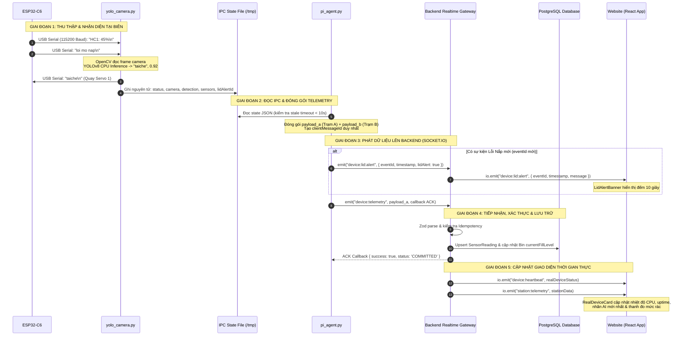
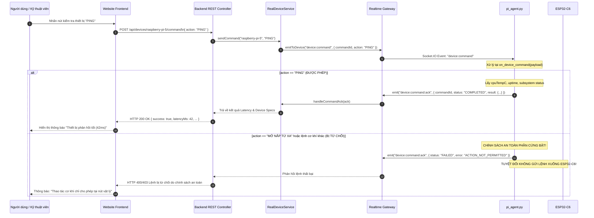
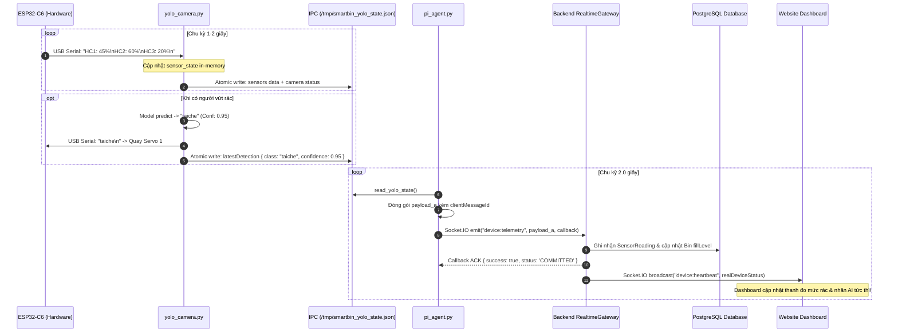
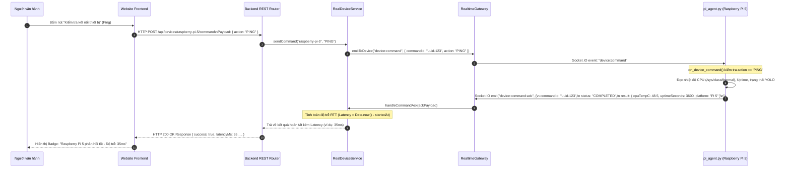
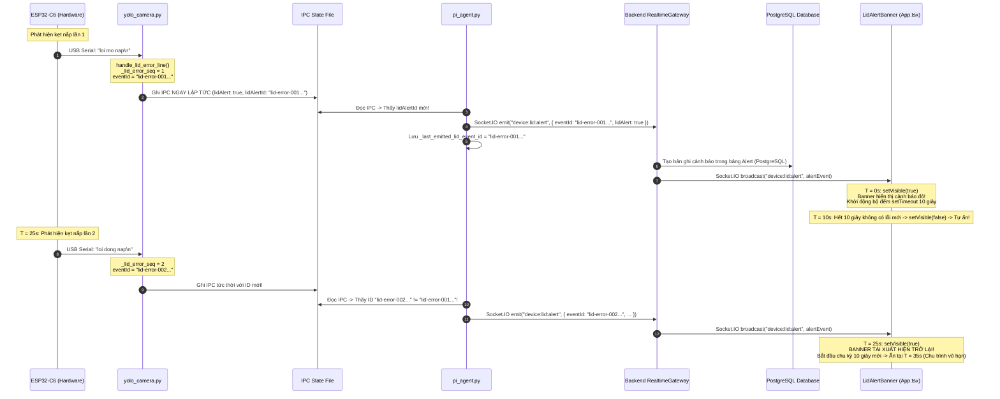

# TÀI LIỆU KỸ THUẬT: NGUYÊN LÝ HOẠT ĐỘNG VÀ CƠ CHẾ TƯƠNG TÁC TOÀN HỆ THỐNG SMARTBIN
## KIẾN TRÚC TƯƠNG TÁC GIỮA WEBSITE, BACKEND, RASPBERRY PI 5 VÀ ESP32-C6

> **Dành cho:** Sinh viên ngành Kỹ thuật Máy tính / Hệ thống Nhúng / Công nghệ Thông tin  
> **Mục đích:** Nghiên cứu kiến trúc, hiểu sâu luồng dữ liệu thực tế và chuẩn bị bảo vệ đồ án, trả lời phản biện trước Hội đồng Giảng viên.  
> **Căn cứ mã nguồn:** Toàn bộ mã nguồn thực tế tại repository `SMARTBIN` (Bao gồm các package `apps/device`, `apps/api`, `apps/web`).

---

# MỤC LỤC
1. [TỔNG QUAN HỆ THỐNG & MỤC TIÊU THIẾT KẾ](#1-tổng-quan-hệ-thống--mục-tiêu-thiết-kế)
2. [PHÂN TÍCH KIẾN TRÚC TỔNG THỂ](#2-phân-tích-kiến-trúc-tổng-thể)
   - 2.1. Tầng Giao diện Người dùng (Frontend - React 19)
   - 2.2. Tầng Máy chủ Trung gian (Backend - Node.js / Express 5 / NestJS Architecture)
   - 2.3. Tầng Cơ sở Dữ liệu (PostgreSQL / SQLite Dual Engine)
   - 2.4. Tầng Gateway Biên (Edge Gateway - Raspberry Pi 5)
   - 2.5. Tầng Vi điều khiển Ngoại vi (Microcontroller - ESP32-C6)
   - 2.6. Thị giác Máy tính & Trí tuệ Nhân tạo (YOLO Vision Pipeline)
   - 2.7. Cảm biến & Cơ cấu Chấp hành (Actuators & Sensors)
   - 2.8. Sơ đồ Kiến trúc Tổng thể (Mermaid Architecture Diagram)
3. [CƠ CHẾ TƯƠNG TÁC CHI TIẾT GIỮA WEBSITE, BACKEND VÀ THIẾT BỊ](#3-cơ-chế-tương-tác-chi-tiết-giữa-website-backend-và-thiết-bị)
   - 3.1. Luồng dữ liệu ngược dòng (Uplink: Phần cứng $\rightarrow$ Pi $\rightarrow$ Backend $\rightarrow$ Web)
   - 3.2. Luồng dữ liệu xuôi dòng (Downlink: Web $\rightarrow$ Backend $\rightarrow$ Pi) & Chính sách An toàn Phần cứng (Hardware Safety Policy)
   - 3.3. Phân tích chi tiết 4 tầng giao thức giao tiếp thực tế
4. [PHÂN TÍCH 5 KỊCH BẢN HOẠT ĐỘNG THỰC TẾ](#4-phân-tích-5-kịch-bản-hoạt-động-thực-tế)
   - 4.1. Kịch bản 1: Nhận diện, phân loại rác AI & đóng mở servo tự động
   - 4.2. Kịch bản 2: Đo lường mức đầy và đồng bộ telemetry cảm biến siêu âm
   - 4.3. Kịch bản 3: Thu gom rác bằng nút bấm vật lý GPIO22 trên ESP32-C6
   - 4.4. Kịch bản 4: Cảnh báo lỗi nắp và chu trình tái kích hoạt banner vô hạn
   - 4.5. Kịch bản 5: Mất mạng Internet & cơ chế đệm ngoại tuyến SQLite tự phục hồi
5. [BẢNG TRA CỨU CÁC FILE MÃ NGUỒN CỐT LÕI](#5-bảng-tra-cứu-các-file-mã-nguồn-cốt-lõi)
6. [SƠ ĐỒ TUẦN TỰ (SEQUENCE DIAGRAMS)](#6-sơ-đồ-tuần-tự-sequence-diagrams)
   - Sơ đồ 1: Luồng Telemetry Cảm biến & Nhận diện AI từ ESP32/Pi lên Web
   - Sơ đồ 2: Luồng Lệnh kiểm tra phần cứng (Command Downlink PING) từ Web xuống Pi
   - Sơ đồ 3: Luồng Cảnh báo Lỗi Nắp Thùng rác từ ESP32 đến Banner Website
7. [BÀI THUYẾT TRÌNH MẪU DÀNH CHO SINH VIÊN (5–7 PHÚT)](#7-bài-thuyết-trình-mẫu-dành-cho-sinh-viên-57-phút)
8. [BỘ 18 CÂU HỎI PHẢN BIỆN CHUYÊN SÂU CỦA HỘI ĐỒNG & ĐÁP ÁN](#8-bộ-18-câu-hỏi-phản-biện-chuyên-sâu-của-hội-đồng--đáp-án)

---

# 1. TỔNG QUAN HỆ THỐNG & MỤC TIÊU THIẾT KẾ

**SMARTBIN** là hệ thống quản lý và phân loại rác thải thông minh ứng dụng công nghệ **Edge AI kết hợp IoT (AIoT)**. Hệ thống giải quyết trọn vẹn bài toán từ khâu tiếp nhận rác tại thùng rác thông minh, tự động phân loại bằng thị giác máy tính, đo lường mức độ đầy của từng ngăn rác bằng cảm biến siêu âm, cảnh báo sự cố kẹt nắp, ghi nhận lịch sử thu gom bằng nút bấm vật lý, cho đến việc giám sát và cảnh báo thời gian thực trên giao diện Website tập trung.

### Mục tiêu kiến trúc cốt lõi:
1. **Phân tách trách nhiệm (Separation of Concerns):** Phân chia rõ ràng giữa tầng xử lý thời gian thực cao/điều khiển động cơ (ESP32-C6), tầng tính toán thị giác biên & gateway truyền thông (Raspberry Pi 5), tầng nghiệp vụ & điều phối trung tâm (Backend Node.js/Express) và tầng hiển thị tương tác (Frontend React).
2. **Khả năng chịu lỗi & Độc lập tiến trình (Fault Tolerance):** Tiến trình AI Camera (`yolo_camera.py`) và tiến trình truyền thông mạng (`pi_agent.py`) chạy hoàn toàn tách biệt, giao tiếp qua cơ chế **Atomic File IPC**. Nếu camera mất kết nối hoặc mạng bị đứt, tiến trình còn lại vẫn hoạt động bình thường, không làm sụp đổ toàn bộ hệ thống.
3. **An toàn dữ liệu & Chống trùng lặp (Idempotency & Offline Buffer):** Tích hợp SQLite Buffer ngay trên Raspberry Pi với sức chứa 50,000 gói tin khi mất mạng Internet. Khi mạng phục hồi, dữ liệu được xả lên Backend kèm cơ chế xác thực ACK hai chiều và sổ cái Idempotency Ledger trên cơ sở dữ liệu.
4. **An toàn phần cứng (Hardware Safety Policy):** Toàn bộ thao tác cơ khí công suất lớn (mở đồng loạt 3 servo để thu gom) bắt buộc phải do nhân viên vệ sinh thao tác tại chỗ qua **nút vật lý GPIO22**, loại trừ rủi ro điều khiển từ xa gây tai nạn hoặc chập cháy thiết bị.

---

# 2. PHÂN TÍCH KIẾN TRÚC TỔNG THỂ

Hệ thống SMARTBIN được cấu trúc theo mô hình 4 tầng phân tán:

```mermaid
flowchart TB
    subgraph TANG_1_HARDWARE["1. TẦNG PHẦN CỨNG & CẢM BIẾN (ESP32-C6 + PERIPHERALS)"]
        BTN["Nút bấm thu gom GPIO22\n(INPUT_PULLUP)"]
        CAM["USB Camera\n(/dev/video0)"]
        HC["3 Cảm biến Siêu âm HC-SR04\n(HC1, HC2, HC3)"]
        SERVO["3 Động cơ Servo 360/Góc\n(Servo 1, 2, 3)"]
        ESP32["Vi điều khiển ESP32-C6\n(Firmware: Tram_A_new)"]
        
        BTN -->|LOW/HIGH| ESP32
        HC -->|Echo/Trig pulses| ESP32
        ESP32 -->|PWM pulses| SERVO
    end

    subgraph TANG_2_PI5["2. TẦNG BIÊN XỬ LÝ TRUNG TÂM (RASPBERRY PI 5 - DEBIAN 13 ARM64)"]
        subgraph YOLO_PROC["Tiến trình 1: yolo_camera.py"]
            YOLO_MODEL["Mô hình YOLOv8\n(best.pt CPU Inference)"]
            SERIAL_PARSER["Serial Parser\n(Normalize, Regex, CRC)"]
            SERVO_LOGIC["Logic Re-arm & Debounce\n(1.5s Cooldown)"]
        end

        subgraph IPC_LAYER["Tầng IPC Trạng thái File Nguyên tử"]
            IPC_FILE[("/tmp/smartbin_yolo_state.json\nAtomic Temp File Replace")]
        end

        subgraph AGENT_PROC["Tiến trình 2: pi_agent.py"]
            BRIDGE["smartbin_yolo_bridge.py\n(Read & Validate IPC)"]
            STATION_B["station_b_worker.py\n(Serial Trạm B /dev/ttyUSB1)"]
            SQLITE_BUF[("Offline Buffer SQLite\n/var/lib/smartbin/offline_buffer.db")]
            SIO_CLIENT["Socket.IO Client Python\n(Reconnection & Backoff)"]
        end

        CAM -->|V4L2 Frames| YOLO_MODEL
        ESP32 <-->|USB Serial 115200 Baud\n(/dev/ttyUSB0)| SERIAL_PARSER
        SERIAL_PARSER --> SERVO_LOGIC
        YOLO_MODEL --> SERVO_LOGIC
        SERVO_LOGIC -->|Lệnh nhãn: taiche, huuco...| ESP32
        
        YOLO_PROC -->|Ghi nguyên tử atomically| IPC_FILE
        IPC_FILE -->|Đọc kiểm tra Stale < 10s| BRIDGE
        BRIDGE --> AGENT_PROC
        STATION_B --> AGENT_PROC
        AGENT_PROC <-->|Đệm ngoại tuyến khi mất mạng| SQLITE_BUF
    end

    subgraph TANG_3_BACKEND["3. TẦNG MÁY CHỦ TRUNG TÂM (NODE.JS / EXPRESS 5)"]
        GW["Realtime Gateway\n(Socket.IO Server 4.8)"]
        RDS["RealDeviceService\n(RAM State & Health Check)"]
        CSS["CollectionSessionService\n(Session State Machine & Idempotency)"]
        REST_API["REST API Router\n(/api/dashboard, /api/bins, /api/settings)"]
        PRISMA["Prisma ORM 6"]
        
        SIO_CLIENT <-->|Socket.IO Events & Telemetry ACK| GW
        GW <--> RDS
        GW <--> CSS
        GW --> PRISMA
        REST_API --> PRISMA
    end

    subgraph TANG_4_DB["4. CƠ SỞ DỮ LIỆU CHÍNH (POSTGRESQL / RENDER)"]
        DB[("PostgreSQL\nTables: Station, Bin, SensorReading,\nAlert, CollectionRecord, Watermark")]
        PRISMA <--> DB
    end

    subgraph TANG_5_WEB["5. GIAO DIỆN NGƯỜI DÙNG (REACT 19 / VITE 8 SPA)"]
        APP_SHELL["App Shell & Navigation\n(/dashboard, /bins, /alerts, /settings)"]
        BANNER["LidAlertBanner Component\n(Auto-hide 10s, Infinite Re-trigger)"]
        DASH_VIEW["Dashboard & RealDeviceCard\n(Live AI Badge, 10 Detections, Fill Bars)"]
        ALERTS_VIEW["Alerts Center\n(Unresolved & History)"]
        STORE["Realtime Store & Socket Context\n(Auto Resync on Reconnect)"]
        
        GW <-->|Socket.IO Client WebSocket| STORE
        REST_API <-->|HTTP REST Axios API| APP_SHELL
        STORE --> BANNER
        STORE --> DASH_VIEW
        STORE --> ALERTS_VIEW
    end
```

---

## Chi tiết các thành phần trong mã nguồn

### 2.1. Frontend (`apps/web`)
- **Công nghệ sử dụng:** React 19 (`react: ^19.2.8`), TypeScript 6, Vite 8 (`vite: ^8.2.2`), React Router DOM 7 (`react-router-dom: ^7.9.3`), Socket.IO Client 4.8 (`socket.io-client: ^4.8.1`), Recharts 3 (`recharts: ^3.2.1`), Axios.
- **Thanh điều hướng được tinh gọn (Strict 4 Items):**
  1. `/dashboard` (**Tổng quan**): Hiển thị trạng thái các trạm thu gom (Trạm A, Trạm B), KPI cảnh báo, và card phần cứng thực tế `RealDeviceCard` (CPU Temp, Uptime, trạng thái tiến trình YOLO/Camera, nhãn nhận diện AI tức thời kèm lịch sử 10 lần nhận diện gần nhất, thanh đo mức rác từng ngăn).
  2. `/bins` (**Thùng rác**): Danh sách chi tiết các ngăn thùng rác (Tái chế, Không tái chế, Hữu cơ) với mức đầy trực quan.
  3. `/alerts` (**Cảnh báo**): Trung tâm cảnh báo thống nhất hiển thị các sự cố nghiêm trọng (Lỗi nắp thùng rác, Thùng gần đầy $\ge 70\%$, Thùng đầy nguy cấp $\ge 90\%$, Thiết bị mất kết nối).
  4. `/settings` (**Cài đặt**): Cấu hình ngưỡng cảnh báo mức đầy (Warning, Near-full, Full) lưu xuống Database.
- **Banner Cảnh Báo Lỗi Nắp Toàn Cục (`LidAlertBanner` trong `apps/web/src/App.tsx`):**
  - Độc lập với nội dung các trang con, hiển thị ngay trên đỉnh workspace khi phát hiện lỗi nắp thùng rác từ phần cứng.
  - Tự động đếm lùi và ẩn sau đúng **10 giây**.
  - Sẵn sàng kích hoạt lại vô hạn lần bất cứ khi nào ESP32 phát hiện một lỗi mới.

### 2.2. Backend (`apps/api`)
- **Framework & Công nghệ:** Node.js (ES Modules), Express 5 (`express: ^5.1.0`), TypeScript, Prisma ORM 6 (`@prisma/client: ^6.19.0`), Socket.IO Server 4.8 (`socket.io: ^4.8.3`), Zod 4 Schema Validation, Bcrypt, JsonWebToken.
- **Vai trò trung tâm:**
  - **Quản lý thiết bị trong bộ nhớ RAM (`RealDeviceService`):** Lưu trữ trạng thái hoạt động tức thời (Heartbeat, Uptime, CPU Temp, AiDetection, LidAlert) của Raspberry Pi 5 và ESP32-C6. Cung cấp cơ chế tính toán trạng thái ONLINE/WARNING/OFFLINE theo ngưỡng thời gian thực (SLA 30 giây timeout).
  - **Cổng giao tiếp thời gian thực (`RealtimeGateway`):** Thiết lập kênh Socket.IO hai chiều. Nhận telemetry từ Pi Agent kèm cơ chế phản hồi xác nhận **ACK Callback**; phát sóng tức thời các sự kiện (`device:heartbeat`, `device:lid:alert`, `alert:created`, `device:status`) tới trình duyệt Web.
  - **Xử lý nghiệp vụ thu gom (`CollectionSessionService`):** Máy trạng thái hữu hạn (FSM) xử lý phiên thu gom rác. Đảm bảo tính **Idempotent (chống trùng lặp)** khi nhận các sự kiện `OPEN` và `CLOSE` từ nút vật lý ESP32.

### 2.3. Cơ sở dữ liệu (Database)
- **Hệ quản trị CSDL:** PostgreSQL (chạy trên hạ tầng Cloud / Render) sử dụng Prisma Client. Dự án hỗ trợ cả schema SQLite song song để phục vụ kiểm thử cục bộ (`schema.sqlite.prisma`).
- **Các nhóm bảng dữ liệu quan trọng:**
  - `DeviceStatus`: Quản lý thông tin thiết bị, firmware, IP, thời gian heartbeat cuối và siêu dữ liệu.
  - `Station` & `Bin`: Quản lý danh mục trạm thu gom và các ngăn thùng rác tương ứng (mã ngăn, dung tích, vị trí địa lý, mức đầy hiện tại).
  - `SensorReading`: Nhật ký chuỗi thời gian (time-series) lưu lại các lần đo mức đầy từ cảm biến siêu âm.
  - `Alert`: Lưu trữ các bản ghi cảnh báo (Loại cảnh báo, Mức độ nghiêm trọng, Tin nhắn, Trạng thái giải quyết `isResolved`, Thời điểm tạo và thời điểm giải quyết).
  - `CollectionRecord`: Lưu trữ lịch sử các phiên thu gom rác (Thời gian bắt đầu, kết thúc, mức đầy trước và sau thu gom, mã phiên `sessionId`).
  - `StationWatermark` & `TelemetryIdempotencyLedger`: Sổ cái chống ghi nhận trùng lặp dữ liệu telemetry.
  - `SystemSetting`: Lưu trữ cấu hình ngưỡng cảnh báo mức đầy hệ thống.

### 2.4. Raspberry Pi 5 (Edge Processing & Gateway)
- **Môi trường:** Hệ điều hành Debian 13 (Trixie/ARM64) 64-bit, Python 3.11+.
- **Kiến trúc hai tiến trình độc lập (Two-Process Architecture):**
  1. `yolo_camera.py`: Độc quyền truy cập phần cứng thị giác (USB Camera qua OpenCV VideoCapture V4L2) và cổng nối tiếp USB Serial Trạm A (`/dev/ttyUSB0`). Chạy mô hình YOLOv8 trên CPU, xử lý nhận diện, gửi chuỗi điều khiển servo xuống ESP32, đọc chuỗi cảm biến siêu âm và cảnh báo lỗi nắp, sau đó ghi nguyên tử vào file IPC trung gian `/tmp/smartbin_yolo_state.json`.
  2. `pi_agent.py`: Tiến trình Gateway nền (Daemon) chịu trách nhiệm giao tiếp mạng. Định kỳ đọc file IPC qua module `smartbin_yolo_bridge.py`, đóng gói bản tin telemetry, quản lý hàng đợi ngoại tuyến SQLite `offline_buffer.py`, và duy trì kết nối Socket.IO bảo mật tới Backend.
  - Đồng thời quản lý tiểu trình phụ `station_b_worker.py` để kết nối và đọc cảm biến độc lập từ vi điều khiển Trạm B qua cổng `/dev/smartbin_station_b`.

### 2.5. ESP32-C6 (Hardware Control Microcontroller)
- **Firmware:** File `Tram_A_new(3)` nạp trên ESP32-C6.
- **Nhiệm vụ chuyên biệt:**
  - **Điều khiển 3 Động cơ Servo:** Quay cánh lật mở nắp tương ứng từng ngăn rác (Ngăn 1: Tái chế, Ngăn 2: Không tái chế, Ngăn 3: Hữu cơ) khi nhận lệnh chuỗi Serial từ Raspberry Pi.
  - **Đọc 3 Cảm biến Siêu âm HC-SR04 (HC1, HC2, HC3):** Phát xung Trigger, đo độ rộng xung Echo, tính khoảng cách, quy đổi sang phần trăm mức đầy (0% – 100%) và gửi định kỳ lên Raspberry Pi qua USB Serial (ví dụ: `HC1: 45%`).
  - **Phát hiện lỗi nắp cơ khí:** Khi servo gặp kẹt hoặc nắp không thể mở/đóng hoàn tất, phát chuỗi Serial cảnh báo: `loi mo nap` hoặc `loi dong nap`.
  - **Xử lý nút bấm vật lý thu gom rác (GPIO22 - `INPUT_PULLUP`):**
    - Khi người vận hành nhấn nút: Chân GPIO22 xuống mức `LOW`, ESP32 mở đồng loạt cả 3 servo (góc quay 330 độ) và gửi qua Serial: `THU CONG: MO CA 3 SERVO (330 do)`.
    - Khi nhả nút: Chân GPIO22 lên mức `HIGH`, ESP32 đóng 3 servo và gửi qua Serial: `TU DONG: TIEP TUC`.

---

# 3. CƠ CHẾ TƯƠNG TÁC CHI TIẾT GIỮA WEBSITE, BACKEND VÀ RASPBERRY PI

## 3.1. Luồng dữ liệu ngược dòng (Uplink: Phần cứng $\rightarrow$ Pi $\rightarrow$ Backend $\rightarrow$ Web)

Đây là xương sống vận hành của hệ thống, diễn ra liên tục theo chu kỳ thời gian thực:



### Các bước xử lý chi tiết:
1. **Thu thập dữ liệu phần cứng:**
   - Camera USB truyền các khung hình video độ phân giải 640x480 qua giao thức V4L2 vào bộ đệm của OpenCV.
   - ESP32-C6 liên tục đọc tín hiệu cảm biến và ghi các dòng văn bản kết thúc bằng ký tự xuống dòng `\n` vào cổng USB Serial (UART qua giao tiếp chuyển đổi USB-to-UART CP2102/CH340).
2. **Xử lý và tổng hợp tại tiến trình YOLO:**
   - Hàm `read_esp32()` trong `yolo_camera.py` đọc bộ đệm Serial, tách dòng và đưa qua bộ chuẩn hóa chuỗi `normalize_lid_serial_line()` và `normalize_collection_serial_line()`.
   - Kết quả nhận diện AI từ `model.predict()` được trích xuất thành đối tượng `{ class, confidence, timestamp }`.
   - Dữ liệu cảm biến và nhận diện được tổng hợp và xuất bản ra file IPC `/tmp/smartbin_yolo_state.json` thông qua module `smartbin_yolo_bridge.py`.
3. **Tiến trình Pi Agent đóng gói và gửi lên Backend:**
   - Cứ mỗi chu kỳ **2.0 giây** (`TELEMETRY_INTERVAL = 2.0`), hàm `send_telemetry()` trong `pi_agent.py` được đánh thức.
   - Hàm kiểm tra tính tươi mới của file IPC (nếu file cũ hơn 10 giây do YOLO bị treo, cờ trạng thái sẽ tự động chuyển thành `yolo: STOPPED, camera: DISCONNECTED`).
   - Nếu phát hiện có mã lỗi nắp mới (`lidAlertId` khác với mã đã phát trước đó), Pi Agent lập tức phát sự kiện chuyên biệt `device:lid:alert`.
   - Toàn bộ telemetry của Trạm A và Trạm B được gửi lên Backend qua sự kiện `device:telemetry` kèm theo một hàm **ACK callback**.
4. **Backend tiếp nhận và xử lý:**
   - Backend sử dụng Zod schema `deviceTelemetryInputSchema` để xác thực toàn bộ cấu trúc dữ liệu.
   - Cập nhật thông tin sống của thiết bị vào RAM trong `RealDeviceService` (nhiệt độ CPU, uptime, trạng thái các hệ thống con, nhãn AI, lịch sử nhận diện).
   - Kiểm tra ngưỡng cảm biến siêu âm. Nếu mức đầy $\ge 70\%$ hoặc $\ge 90\%$, tạo bản ghi cảnh báo trong bảng `Alert` của PostgreSQL.
   - Ghi dữ liệu vào bảng `SensorReading` và cập nhật cột `currentFillLevel` của bảng `Bin`.
   - Phản hồi lại cho Pi Agent qua callback: `{ success: true, status: 'COMMITTED' }`.
5. **Website cập nhật thời gian thực:**
   - Ngay khi nhận được `device:telemetry`, Backend lập tức phát sóng Socket.IO tới tất cả các trình duyệt Web đang kết nối:
     - `device:heartbeat`: Mang toàn bộ dữ liệu telemetry thực tế của Raspberry Pi 5. Card thiết bị `RealDeviceCard` trên Dashboard tự động cập nhật ngay lập tức mà không cần F5 tải lại trang.
     - `device:lid:alert`: Kích hoạt component `LidAlertBanner` bật sáng thanh cảnh báo màu đỏ với chuông cảnh báo.

---

## 3.2. Luồng dữ liệu xuôi dòng (Downlink: Web $\rightarrow$ Backend $\rightarrow$ Pi) & Chính sách An toàn Phần cứng

Trong các hệ thống điều khiển công nghiệp và IoT, chiều dữ liệu gửi lệnh từ Web xuống thiết bị đòi hỏi phải phân tích kỹ lưỡng giữa khả năng hỗ trợ trên lý thuyết và mã nguồn thực tế:



### Phân định rõ ràng giữa Hỗ trợ và Không hỗ trợ:

1. **Lệnh được hỗ trợ thực tế trong mã nguồn: Lệnh `PING`**
   - **Mục đích:** Kiểm tra độ trễ (Round-Trip Time / Latency) giữa Website và Raspberry Pi 5 thực tế, đồng thời kiểm tra sức khỏe hệ thống tức thời.
   - **Đường đi:** Website gọi `POST /api/devices/:id/command` $\rightarrow$ Backend tạo `commandId` ngẫu nhiên và gửi sự kiện Socket.IO `device:command` tới room của thiết bị $\rightarrow$ `pi_agent.py` nhận sự kiện tại hàm `on_device_command()` $\rightarrow$ Đọc nhiệt độ CPU, uptime, trạng thái YOLO $\rightarrow$ Gửi ngược lại `device:command:ack` $\rightarrow$ Backend tính độ trễ miligiây $\rightarrow$ Trả kết quả về cho Website.
2. **Lệnh KHÔNG hỗ trợ từ xa và lý do kỹ thuật (Hardware Safety Policy):**
   - Trong `pi_agent.py`, các dòng lệnh từ 276 đến 289 quy định rõ:
     ```python
     else:
         ack = {
             'commandId': command_id,
             'deviceId': DEVICE_ID,
             'action': action,
             'status': 'FAILED',
             'message': f"Lệnh '{action}' không được phép thực thi trong giai đoạn này. Chỉ cho phép PING.",
             'error': 'ACTION_NOT_PERMITTED',
             'executedAt': datetime.now(timezone.utc).isoformat()
         }
         if sio:
             sio.emit('device:command:ack', ack)
     ```
   - **Nguyên nhân an toàn:** Hệ thống **tuyệt đối không cho phép Website gửi lệnh mở nắp servo qua Internet**. Thùng rác công cộng tiềm ẩn rủi ro kẹt tay người dùng hoặc sự cố vật cản cơ khí. Việc mở nắp để thu gom bắt buộc phải diễn ra tại chỗ bằng nút bấm vật lý dưới sự giám sát trực tiếp của nhân viên vệ sinh.

---

## 3.3. Phân tích 4 tầng giao thức giao tiếp thực tế

Mọi giao tiếp trong hệ thống SMARTBIN đều có bằng chứng trực tiếp trong mã nguồn:

| Giao thức | Hai thành phần giao tiếp | Định dạng dữ liệu | Vai trò bên gửi & bên nhận | Lý do kiến trúc lựa chọn |
| :--- | :--- | :--- | :--- | :--- |
| **USB Serial (UART)** | ESP32-C6 $\leftrightarrow$ Raspberry Pi 5 (`/dev/ttyUSB0`) | Text-based Protocol (`\n` terminated lines, ASCII/UTF-8). Ví dụ: `HC1: 45%`, `loi mo nap`, `taiche`. | - **ESP32:** Đo cảm biến, bắt sự kiện nút bấm, xuất dòng văn bản.<br/>- **Pi 5 (`yolo_camera.py`):** Phân tích cú pháp Regex, gửi nhãn phân loại (`taiche\n`). | Đơn giản, độ tin cậy cao, độ trễ cực thấp (< 5ms), không phụ thuộc vào hạ tầng mạng WiFi/IP, chống nhiễu tốt qua kết nối cáp USB vật lý. |
| **Atomic File IPC** | `yolo_camera.py` $\rightarrow$ `pi_agent.py` | JSON Schema lưu tại file `/tmp/smartbin_yolo_state.json`. | - **`yolo_camera.py` (Producer):** Ghi tạm ra file ẩn bằng `NamedTemporaryFile` rồi đổi tên nguyên tử bằng `os.replace()`.<br/>- **`pi_agent.py` (Consumer):** Đọc nội dung JSON, xác thực schema và kiểm tra độ trễ (stale check). | Phân tách hoàn toàn lỗi (Crash isolation): Tiến trình AI nặng về CPU/Camera nếu gặp lỗi bộ nhớ sẽ không làm chết tiến trình mạng; không lo đọc dở file (race condition) nhờ cơ chế hoán đổi nguyên tử của Linux kernel. |
| **WebSocket / Socket.IO** | Raspberry Pi 5 (`pi_agent.py`) $\leftrightarrow$ Backend (`RealtimeGateway`) | JSON Event Packets qua kênh TCP 2 chiều (Events: `device:telemetry`, `device:lid:alert`, `device:command:ack`). | - **Pi Agent (Client):** Duy trì kết nối liên tục, đệm gói khi mất mạng, phát sự kiện kèm ACK callback.<br/>- **Backend (Server):** Tiếp nhận, xác thực schema, lưu DB và phản hồi ACK. | Cho phép truyền thông hai chiều thời gian thực (Full-duplex), độ trễ thấp, hỗ trợ xác nhận ACK có cấu trúc và tự động kết nối lại khi mạng chập chờn. |
| **HTTP / REST API** | Website Frontend $\leftrightarrow$ Backend API | JSON Request / Response (Headers: Bearer JWT Token, Content-Type: application/json). | - **Frontend:** Gửi yêu cầu lấy danh sách trạm, danh sách cảnh báo, cập nhật cấu hình ngưỡng.<br/>- **Backend:** Kiểm tra quyền RBAC (Role-Based Access Control), truy vấn Database qua Prisma và trả về dữ liệu. | Chuẩn mực công nghiệp cho các thao tác CRUD có trạng thái (quản lý người dùng, cấu hình ngưỡng, đăng nhập xác thực). |

---

# 4. PHÂN TÍCH 5 KỊCH BẢN HOẠT ĐỘNG THỰC TẾ

## 4.1. Kịch bản 1: Nhận diện, phân loại rác AI & đóng mở servo tự động

```
[Người dùng đưa rác vào buồng nhận diện]
      │
      ▼
[1. USB Camera thu nhận frame (640x480 V4L2)]
      │
      ▼
[2. yolo_camera.py: Chạy model.predict(best.pt, device='cpu')]
      │
      ▼
[3. Hàm process_detection(): Lọc Confidence >= 0.85 -> Nhãn "taiche"]
      │
      ├───> [4. ESP32-C6: Nhận "taiche\n" qua Serial -> Quay Servo 1 mở ngăn Tái chế]
      │
      └───> [5. Ghi vào IPC: detection = { class: "taiche", confidence: 0.92, ... }]
                  │
                  ▼
            [6. pi_agent.py: Đọc IPC -> Gửi Socket.IO "device:telemetry" lên Backend]
                  │
                  ▼
            [7. Backend: Ghi nhận detectionHistory (10 mục gần nhất)]
                  │
                  ▼
            [8. Website Dashboard: RealDeviceCard cập nhật huy hiệu "Tái chế (92%)"]
```

- **Cơ chế chống rung lặp (Debounce / Rearm Logic):**
  - Trong `yolo_camera.py`, cờ `servo_armed` ban đầu là `True`.
  - Khi rác vừa được nhận diện và lệnh gửi xuống ESP32, cờ lập tức chuyển thành `servo_armed = False` để tránh trường hợp rác đang rơi vẫn bị camera quét lại và kích hoạt servo liên tục.
  - Sau khi vật thể rơi khỏi tầm nhìn của camera đủ **1.5 giây** (`REARM_TIME = 1.5`), hệ thống mới kích hoạt lại `servo_armed = True`, sẵn sàng cho lượt vứt rác tiếp theo.

---

## 4.2. Kịch bản 2: Theo dõi mức đầy và đồng bộ telemetry cảm biến siêu âm

1. **Đo đạc:** Cứ mỗi chu kỳ 1–2 giây, ESP32-C6 kích hoạt cảm biến HC-SR04 của 3 ngăn. Khoảng cách đo được chuyển đổi thành tỷ lệ phần trăm mức đầy:
   $$\text{Fill Level (\%)} = \frac{\text{Chiều cao thùng} - \text{Khoảng cách đo được}}{\text{Chiều cao thùng}} \times 100\%$$
2. **Gửi Serial:** ESP32-C6 in ra cổng Serial:
   ```text
   HC1: 45%
   HC2: 62%
   HC3: 15%
   ```
3. **Phân tích cú pháp tại Pi 5:** `yolo_camera.py` sử dụng Regex `^HC([123]):\s*(\d+)%$` để bóc tách giá trị, lưu vào biến `sensor_state` kèm epoch timestamp.
4. **Đồng bộ IPC & Gửi Telemetry:** `smartbin_yolo_bridge.py` chuẩn hóa số nguyên an toàn (loại trừ giá trị âm hoặc vượt quá 100). `pi_agent.py` ánh xạ thành:
   - `hc1` $\rightarrow$ `recyclable` (45%)
   - `hc2` $\rightarrow$ `nonRecyclable` (62%)
   - `hc3` $\rightarrow$ `organic` (15%)
5. **Lưu trữ & Hiển thị:** Backend ghi vào bảng `SensorReading`, cập nhật mức đầy hiện tại trên card của từng thùng. Nếu mức đầy vượt quá $70\%$, Website hiển thị thanh trạng thái màu cam (Warning); nếu vượt quá $90\%$, chuyển sang màu đỏ (Critical).

---

## 4.3. Kịch bản 3: Thu gom rác bằng nút bấm vật lý GPIO22 trên ESP32-C6

Quy trình thu gom rác thực tế được điều khiển hoàn toàn bằng nút nhấn vật lý:

```
[Nhân viên vệ sinh nhấn giữ nút vật lý GPIO22]
      │
      ▼
[1. ESP32-C6: GPIO22 chuyển mức LOW -> Mở cả 3 Servo (330 độ)]
      │
      ▼
[2. ESP32-C6: Gửi Serial "THU CONG: MO CA 3 SERVO (330 do)"]
      │
      ▼
[3. yolo_camera.py: Nhận diện OPEN -> Sinh sessionId mới (UUIDv4) -> Tạo sự kiện OPEN]
      │
      ▼
[Nhân viên dọn sạch rác và nhả nút vật lý GPIO22]
      │
      ▼
[4. ESP32-C6: GPIO22 chuyển mức HIGH -> Đóng cả 3 Servo -> Gửi "TU DONG: TIEP TUC"]
      │
      ▼
[5. yolo_camera.py: Nhận diện CLOSE -> Khớp đúng sessionId -> Tạo sự kiện CLOSE]
      │
      ▼
[6. pi_agent.py: Đọc sự kiện từ IPC -> Phát Socket.IO "device:collection:event"]
      │
      ▼
[7. Backend: CollectionSessionService tạo ĐÚNG 1 phiên thu gom đại diện cho cả 3 ngăn]
      │
      ▼
[8. Database: Lưu CollectionRecord -> Website cập nhật lịch sử thu gom thời gian thực]
```

- **Quy tắc Idempotency toàn diện:**
  - Nếu đường truyền mạng bị ngắt quãng giữa sự kiện `OPEN` và `CLOSE`, `pi_agent.py` **không xóa sự kiện khỏi hàng đợi** cho đến khi Backend phản hồi ACK thành công.
  - Backend sử dụng `eventId` để kiểm tra: nếu sự kiện đã được lưu vào cơ sở dữ liệu, yêu cầu gửi lại sẽ được trả về kết quả thành công mà không tạo thêm bản ghi trùng lặp.

---

## 4.4. Kịch bản 4: Cảnh báo lỗi nắp và chu trình tái kích hoạt banner vô hạn

Đây là một trong những tính năng phức tạp nhất vừa được hoàn thiện, bảo đảm banner cảnh báo trên Website phản ứng chính xác với mọi lần phát hiện sự cố từ phần cứng:

```
[ESP32-C6 phát hiện kẹt nắp -> Gửi Serial: "loi mo nap"]
      │
      ▼
[1. yolo_camera.py: handle_lid_error_line()]
      ├── Tăng bộ đếm: _lid_error_seq += 1
      ├── Tạo ID duy nhất: lid-error-001-1731300000000-a1b2c3
      └── Gọi _publish_state_safely() ghi IPC NGAY LẬP TỨC (không chờ frame camera)
      │
      ▼
[2. pi_agent.py: send_telemetry()]
      ├── Nhận thấy lidAlertId mới != _last_emitted_lid_event_id
      ├── Phát Socket.IO: emit("device:lid:alert", { eventId: "lid-error-001...", ... })
      └── Lưu _last_emitted_lid_event_id = "lid-error-001..."
      │
      ▼
[3. Backend RealtimeGateway: handleLidAlert(payload, isExplicitEvent=true)]
      ├── Lưu bản ghi cảnh báo vào PostgreSQL (nếu chưa có bản ghi mở)
      └── Broadcast ngay lập tức: io.emit("device:lid:alert", alertEvent)
      │
      ▼
[4. Website Frontend: LidAlertBanner trong App.tsx]
      ├── T = 0s: setVisible(true) -> Hiển thị banner đỏ toàn màn hình
      ├── Đặt timer đếm lùi 10 giây: setTimeout(..., 10000)
      └── T = 10s: Hết 10 giây không có lỗi mới -> setVisible(false) -> Tự ẩn banner
      │
      ▼
[5. Các chu kỳ telemetry định kỳ 2s/lần tiếp theo (T = 11s đến T = 24s)]
      └── lidAlertId không đổi -> Pi Agent BỎ QUA không phát lại -> Banner KHÔNG bị bật lại
      │
      ▼
[6. T = 25s: ESP32-C6 phát hiện lỗi mới -> Gửi Serial: "loi dong nap"]
      ├── yolo_camera.py tạo ID mới: lid-error-002-1731300025000-d4e5f6
      ├── Pi Agent phát hiện ID mới -> Phát tiếp "device:lid:alert"
      ├── Backend broadcast tới Website
      └── T = 25s: Banner TÁI XUẤT HIỆN TRỞ LẠI -> Đếm lùi 10 giây mới -> Ẩn tại T = 35s!
```

- **Phân biệt hai khái niệm cảnh báo:**
  - **Banner thông báo tức thời (`LidAlertBanner`):** Chỉ tồn tại đúng 10 giây kể từ thời điểm phát sinh lỗi gần nhất để gây chú ý trực quan cho người đang nhìn màn hình.
  - **Bản ghi cảnh báo trong Database & Trung tâm Cảnh báo (`/alerts`):** Duy trì liên tục với trạng thái `isResolved = false` cho đến khi nhân viên kỹ thuật nhấn xử lý hoặc kiểm tra phần cứng.

---

## 4.5. Kịch bản 5: Mất kết nối hoặc thiết bị ngoại tuyến

1. **Phát hiện mất kết nối mạng:**
   - Khi mất kết nối Internet giữa Raspberry Pi 5 và Backend, thư viện `python-socketio` kích hoạt callback `disconnect()`.
   - `pi_agent.py` kích hoạt cơ chế thử lại có backoff theo hàm mũ (`_socket_retry_delay` từ 2s tăng dần lên tối đa 30s).
2. **Cơ chế đệm ngoại tuyến (SQLite Offline Buffer):**
   - Trong thời gian ngoại tuyến, các gói telemetry của Trạm A và Trạm B không bị vứt bỏ mà được lưu vào cơ sở dữ liệu SQLite cục bộ tại `/var/lib/smartbin/offline_buffer.db` với trạng thái `QUEUED` (sức chứa tối đa **50,000 gói tin**).
3. **Phục hồi và xả đệm:**
   - Khi mạng kết nối trở lại (`sio.connected = True`), hàm `drain_offline_buffer()` đọc từng lô 10 gói tin (`peek_batch`), gửi lên Backend qua `device:telemetry`.
   - **Chỉ sau khi Backend gửi lại ACK `{ success: true, status: 'COMMITTED' }`**, gói tin mới được đánh dấu `ACKED` và xóa khỏi SQLite.
4. **Phía Website & Backend:**
   - Nếu quá **30 giây** Backend không nhận được tín hiệu Heartbeat từ Raspberry Pi 5, hàm `getStatus()` trong `RealDeviceService` tự động chuyển trạng thái của thiết bị thành `OFFLINE`.
   - Backend phát sự kiện `device:heartbeat` báo trạng thái `OFFLINE`.
   - Website đổi huy hiệu trên Dashboard sang màu đỏ xám "OFFLINE" và hiển thị thời gian mất kết nối.

---

# 5. BẢNG TRA CỨU CÁC FILE MÃ NGUỒN CỐT LÕI

| Tên File | Thành phần | Nhiệm vụ chính trong hệ thống | Dữ liệu đầu vào (Input) | Dữ liệu đầu ra (Output) |
| :--- | :--- | :--- | :--- | :--- |
| **`yolo_camera.py`** | Edge Device (Pi 5) | Đọc Camera USB, chạy suy luận YOLOv8, đọc Serial ESP32, xử lý nút thu gom, phát hiện lỗi nắp, điều khiển servo. | Khung hình camera V4L2; Dòng văn bản USB Serial từ ESP32 (`HC1: 45%`, `loi mo nap`...). | Lệnh Serial điều khiển servo (`taiche\n`); Ghi trạng thái nguyên tử vào file IPC JSON. |
| **`smartbin_yolo_bridge.py`** | Edge Device (Pi 5) | Tầng trung gian đọc/ghi an toàn file trạng thái IPC giữa hai tiến trình Python; chuẩn hóa số liệu cảm biến. | Dữ liệu thô từ `yolo_camera.py` hoặc file `/tmp/smartbin_yolo_state.json`. | Dictionary Python đã được xác thực an toàn, không có giá trị rác hoặc lỗi cú pháp. |
| **`pi_agent.py`** | Edge Device (Pi 5) | Tiến trình Daemon kết nối Socket.IO lên Backend; quản lý đệm ngoại tuyến SQLite; xử lý lệnh PING downlink. | File trạng thái IPC; Tiểu trình Trạm B; Lệnh Socket.IO từ Backend (`device:command`). | Gói tin Socket.IO `device:telemetry`, `device:lid:alert`, `device:command:ack`. |
| **`offline_buffer.py`** | Edge Device (Pi 5) | Quản lý CSDL SQLite cục bộ lưu trữ các gói tin khi đứt mạng, kiểm soát vòng đời QUEUED $\rightarrow$ ACKED. | Gói tin telemetry dạng chuỗi JSON khi mất mạng. | Các lô gói tin cần gửi bù khi có mạng lại; xóa an toàn các gói đã commit. |
| **`station_b_worker.py`** | Edge Device (Pi 5) | Tiểu trình đọc Serial độc lập cho Trạm B qua cổng `/dev/smartbin_station_b`, kiểm tra Checksum CRC16. | Dòng Serial văn bản hoặc gói NDJSON từ ESP32 Trạm B. | Dictionary cảm biến của Trạm B chuyển cho `pi_agent.py`. |
| **`realtime.gateway.ts`** | Backend (Node.js) | Cổng Socket.IO Server trung tâm; tiếp nhận telemetry; broadcast sự kiện thời gian thực; gửi lệnh xuống Pi. | Kết nối Socket.IO từ Pi 5 và từ trình duyệt Web; Dữ liệu telemetry thô. | Các sự kiện Socket.IO phát sóng: `device:heartbeat`, `device:lid:alert`, `alert:created`... |
| **`real-device.service.ts`** | Backend (Node.js) | Quản lý trạng thái thiết bị trong RAM; duy trì vòng đời kết nối; lưu vết lịch sử nhận diện AI; tính toán SLA online/offline. | Gói tin telemetry đã xác thực từ Gateway; Lệnh PING từ REST Controller. | Trạng thái thiết bị `RealDeviceStatus`; Kết quả thực thi lệnh PING kèm thời gian phản hồi. |
| **`collection-session.service.ts`** | Backend (Node.js) | Quản lý máy trạng thái phiên thu gom rác; bảo đảm tính Idempotent; tạo 1 bản ghi duy nhất cho 3 ngăn thùng rác. | Sự kiện thu gom `OPEN`/`CLOSE` từ Pi 5 (`device:collection:event`). | Bản ghi `CollectionRecord` lưu vào CSDL; sự kiện `collection:session:updated`. |
| **`App.tsx`** | Frontend (React) | Shell giao diện chính; chứa Router điều hướng; tích hợp component `LidAlertBanner` cảnh báo nắp toàn cục. | Sự kiện Socket.IO `device:lid:alert`; Trạng thái đăng nhập của người dùng. | Giao diện thanh điều hướng 4 mục; Banner cảnh báo đỏ tự ẩn sau 10 giây. |
| **`real-device-card.tsx`** | Frontend (React) | Card hiển thị phần cứng Pi 5 trên Dashboard (Nhiệt độ CPU, Uptime, Nhãn AI thời gian thực, Lịch sử nhận diện). | Sự kiện Socket.IO `device:heartbeat` từ Backend. | Giao diện thẻ phần cứng động với các chỉ số hoạt động cập nhật từng giây. |
| **`dashboard.tsx`** | Frontend (React) | Trang Tổng quan hiển thị KPI, danh sách trạm thu gom và Trung tâm Cảnh báo thống nhất. | REST API `/api/dashboard/*` và Socket.IO events. | Bảng điều khiển giám sát toàn diện trạm thông minh. |
| **`Tram_A_new(3)` (Firmware)** | Embedded (ESP32-C6) | Firmware C++/Arduino nạp trên ESP32-C6 Trạm A; điều khiển 3 servo, đọc 3 cảm biến siêu âm, đọc nút nhấn GPIO22. | Xung phản hồi cảm biến siêu âm; Mức logic nút bấm GPIO22; Chuỗi UART từ Pi (`taiche\n`). | Xung PWM điều khiển Servo; Chuỗi Serial gửi lên Pi (`HC1: 45%`, `loi mo nap`...). |

---

# 6. SƠ ĐỒ TUẦN TỰ (SEQUENCE DIAGRAMS)

## Sơ đồ 1: Luồng Telemetry Cảm biến & Nhận diện AI từ ESP32/Pi lên Website



## Sơ đồ 2: Luồng Lệnh kiểm tra phần cứng (PING Command Downlink) từ Website xuống Pi



## Sơ đồ 3: Luồng Cảnh báo Lỗi Nắp Thùng rác từ ESP32 đến Banner Website



---

# 7. BÀI THUYẾT TRÌNH MẪU DÀNH CHO SINH VIÊN (5–7 PHÚT)

> *Gợi ý: Sinh viên có thể sử dụng bài phát biểu này để mở đầu buổi báo cáo đồ án trước Hội đồng chấm thi.*

"Kính thưa quý Thầy, Cô trong Hội đồng phản biện,

Em xin đại diện nhóm thực hiện đề tài trình bày về **Nguyên lý hoạt động và Kiến trúc tương tác toàn hệ thống Thùng rác Thông minh SMARTBIN**.

Trong bối cảnh đô thị thông minh hiện nay, bài toán thu gom và phân loại rác thải tại nguồn gặp hai thách thức lớn: Thứ nhất là ý thức phân loại của người dân chưa đồng đều; thứ hai là công tác quản lý và giám sát tình trạng thùng rác tại các điểm thu gom phần lớn vẫn làm thủ công, dẫn đến tình trạng thùng rác bị quá tải hoặc hư hỏng nắp cơ khí mà đơn vị quản lý không nắm bắt kịp thời.

Hệ thống SMARTBIN được chúng em thiết kế theo mô hình **AIoT 4 tầng phân tán hoàn chỉnh**:
- **Tại trạm thu gom**, chúng em sử dụng **Raspberry Pi 5** đóng vai trò là Bộ xử lý biên trung tâm (Edge Gateway), kết hợp với vi điều khiển **ESP32-C6** phụ trách điều khiển cơ cấu chấp hành và cảm biến.
- **Tại máy chủ**, hệ thống sử dụng **Backend Node.js và CSDL PostgreSQL**, giao tiếp với thiết bị qua giao thức truyền thông hai chiều thời gian thực **Socket.IO**.
- **Tại tầng quản lý**, chúng em xây dựng ứng dụng Web SPA bằng **React 19**, cho phép giám sát trực quan các chỉ số kỹ thuật và cảnh báo sự cố tức thời.

**Nguyên lý vận hành thực tế của hệ thống diễn ra như sau:**
1. **Thứ nhất, ở luồng phân loại rác tự động:** Khi người dùng đưa rác vào buồng tiếp nhận, Camera USB sẽ ghi nhận hình ảnh và chuyển tới tiến trình `yolo_camera.py`. Tại đây, mô hình YOLOv8 được suy luận trực tiếp trên CPU của Raspberry Pi 5 để phân loại rác thành 3 nhóm: Tái chế, Không tái chế hoặc Hữu cơ. Ngay khi có nhãn hợp lệ, Pi 5 phát một lệnh UART ngắn qua cổng USB Serial xuống ESP32-C6 để kích hoạt servo mở đúng ngăn rác đó. Đồng thời, một cơ chế re-arm khóa trễ 1.5 giây được áp dụng để ngăn ngừa việc servo bị giật hoặc kích hoạt lặp lại khi rác đang rơi.
2. **Thứ hai, ở luồng đo mức đầy và giám sát từ xa:** Định kỳ 2 giây, ESP32-C6 đo khoảng cách từ 3 cảm biến siêu âm HC-SR04 và gửi lên Raspberry Pi. Để đảm bảo tính ổn định tối đa cho hệ thống nhúng, chúng em tách Raspberry Pi thành hai tiến trình độc lập: Tiến trình YOLO Camera và tiến trình Pi Agent. Hai tiến trình này giao tiếp với nhau bằng cơ chế **Atomic File IPC** qua file `/tmp/smartbin_yolo_state.json`. Nhờ vậy, nếu camera bị ngắt kết nối thì luồng truyền dữ liệu mạng vẫn không bị gián đoạn.
3. **Thứ ba, cơ chế đệm ngoại tuyến (Offline Buffer) khi mất Internet:** Nếu mạng WiFi tại trạm bị sự cố, Pi Agent sẽ tự động chuyển các gói tin telemetry vào CSDL SQLite nội bộ với sức chứa lên tới 50,000 gói tin. Khi có mạng trở lại, hệ thống sẽ xả đệm dần lên máy chủ và chỉ xóa bản ghi sau khi máy chủ phản hồi xác nhận ACK thành công, đảm bảo không bao giờ thất thoát dữ liệu lịch sử.
4. **Thứ tư, tính năng cảnh báo kẹt nắp theo chu trình lặp vô hạn:** Khi cơ cấu nắp gặp sự cố cơ khí, ESP32 sẽ gửi chuỗi cảnh báo lên Pi 5. Hệ thống sẽ sinh một mã sự kiện duy nhất (`eventId`), đẩy qua Backend và làm xuất hiện một banner cảnh báo màu đỏ nổi bật trên Website trong đúng 10 giây rồi tự động ẩn đi để tránh làm phiền giao diện. Nếu vài phút hoặc vài giờ sau lại có một sự cố mới, banner sẽ ngay lập tức được tái kích hoạt trở lại.
5. **Cuối cùng, về mặt an toàn phần cứng:** Chúng em áp dụng chính sách an toàn nghiêm ngặt: Tuyệt đối không cho phép Website gửi lệnh mở nắp cơ khí từ xa qua Internet nhằm tránh tai nạn kẹt tay người dùng. Thay vào đó, việc mở đồng loạt cả 3 ngăn để thu gom bắt buộc phải do nhân viên vệ sinh thao tác tại chỗ thông qua nút bấm vật lý trên ESP32-C6.

Sau đây, nhóm chúng em xin phép được trình chiếu video chạy thử nghiệm thực tế trên phần cứng và sẵn sàng lắng nghe các câu hỏi nhận xét, phản biện từ quý Thầy, Cô. Em xin chân thành cảm ơn!"

---

# 8. BỘ 18 CÂU HỎI PHẢN BIỆN CHUYÊN SÂU CỦA HỘI ĐỒNG & ĐÁP ÁN

### Câu 1: Vì sao nhóm chọn Raspberry Pi 5 làm bộ xử lý trung tâm mà không phải Raspberry Pi 4 hay một máy tính công nghiệp?
**Đáp án:**  
Raspberry Pi 5 sở hữu vi xử lý Broadcom BCM2712 Quad-core Cortex-A76 tốc độ 2.4GHz, cho hiệu năng đơn nhân và đa nhân cao gấp 2.5 đến 3 lần so với Raspberry Pi 4. Điều này cho phép chạy mô hình suy luận thị giác máy tính YOLOv8 trực tiếp trên CPU với tốc độ đạt từ 15 đến 20 FPS ở độ phân giải 640x480 mà không cần gắn thêm phần cứng tăng tốc đồ họa đắt tiền như Google Coral TPU hay card đồ họa rời, vừa đảm bảo tính kinh tế vừa đáp ứng hoàn hảo yêu cầu nhận diện thời gian thực tại biên.

### Câu 2: Vì sao cần thêm vi điều khiển ESP32-C6 mà không cắm trực tiếp tất cả cảm biến và servo vào chân GPIO của Raspberry Pi 5?
**Đáp án:**  
Đây là nguyên lý thiết kế hệ thống nhúng chuẩn:
1. **Đặc tính thời gian thực (Real-time determinism):** Raspberry Pi 5 chạy hệ điều hành Linux đa nhiệm (General-Purpose OS), nhân Linux không phải là RTOS nên việc tạo xung PWM cho servo hoặc đo độ rộng xung Echo micro-giây của cảm biến siêu âm HC-SR04 sẽ bị sai số nghiêm trọng do xung đột phân bổ thời gian của CPU (Jitter).
2. **Vi điều khiển chuyên dụng:** ESP32-C6 là vi điều khiển thời gian thực (Bare-metal/FreeRTOS), chịu trách nhiệm sinh xung PWM chuẩn xác và ngắt phần cứng đo cảm biến siêu âm cực kỳ ổn định.
3. **Cách ly an toàn điện (Galvanic/Hardware Isolation):** Các động cơ servo là tải cảm ứng có dòng khởi động lớn và có thể tạo xung điện áp ngược (Back-EMF). Việc đấu nối qua ESP32-C6 giúp cách ly và bảo vệ các chân GPIO đắt tiền của bo mạch Raspberry Pi 5.

### Câu 3: Pi Agent có nhiệm vụ gì? Tại sao không để tiến trình `yolo_camera.py` gửi thẳng dữ liệu lên Backend?
**Đáp án:**  
Nhóm áp dụng nguyên lý **Đơn nhiệm (Single Responsibility Principle)** và **Cô lập lỗi (Fault Isolation)**:
- `yolo_camera.py` tập trung 100% tài nguyên CPU cho việc đọc khung hình từ Camera qua V4L2, suy luận AI và xử lý Serial với ESP32. Nếu tiến trình này phải đảm nhận thêm việc kết nối mạng Socket.IO, các tình huống nghẽn mạng, DNS timeout hay mất kết nối sẽ làm chặn (block) vòng lặp camera, gây giật lag hình ảnh và trễ phản hồi servo.
- `pi_agent.py` chạy nền hoàn toàn độc lập, đảm nhận toàn bộ logic mạng, hàng đợi SQLite offline, cơ chế kết nối lại và xử lý lệnh kiểm tra PING từ xa. Hai tiến trình giao tiếp qua file IPC nguyên tử nên sự cố của tiến trình này không làm sụp đổ tiến trình kia.

### Câu 4: Mô hình YOLO giao tiếp với Website như thế nào?
**Đáp án:**  
YOLO không giao tiếp trực tiếp với Website mà đi qua chuỗi liên kết 4 bước:
1. `yolo_camera.py` suy luận ra nhãn và ghi đối tượng `{ class, confidence, timestamp }` vào file IPC `/tmp/smartbin_yolo_state.json`.
2. `pi_agent.py` đọc file IPC, đóng gói vào trường `aiDetection` của gói tin `payload_a`.
3. `pi_agent.py` gửi sự kiện Socket.IO `device:telemetry` lên Backend.
4. Backend lưu nhãn vào mảng `detectionHistory` trong RAM (`RealDeviceService`) và phát sóng sự kiện `device:heartbeat` qua WebSocket tới Website để hiển thị badge nhãn nhận diện trên giao diện.

### Câu 5: Giao thức Socket.IO khác REST API ở điểm nào trong hệ thống này? Tại sao không dùng hoàn toàn REST API?
**Đáp án:**  
- **REST API (HTTP/1.1):** Hoạt động theo cơ chế Request-Response một chiều không trạng thái. Client phải chủ động gửi request thì Server mới trả dữ liệu. Nếu dùng REST API để cập nhật mức đầy và cảnh báo, Website sẽ phải liên tục gửi request thăm dò (Polling) mỗi giây, gây lãng phí băng thông, tải máy chủ cao và tạo độ trễ thông tin.
- **Socket.IO (WebSocket):** Thiết lập một kết nối TCP hai chiều liên tục (Full-duplex persistent connection). Khi có rác mới hoặc có sự cố lỗi nắp, Backend có thể chủ động **đẩy ngay lập tức (Server Push)** sự kiện xuống trình duyệt với độ trễ dưới 50ms mà không cần Client phải hỏi trước. Do đó, hệ thống kết hợp: Dùng Socket.IO cho luồng dữ liệu thời gian thực và dùng REST API cho các thao tác cấu hình, xác thực người dùng.

### Câu 6: Tại sao cần một Backend trung gian mà không cho Raspberry Pi kết nối trực tiếp vào Database PostgreSQL?
**Đáp án:**  
1. **Bảo mật (Security):** Nếu để Raspberry Pi kết nối trực tiếp vào Database, chuỗi kết nối (Database Connection String kèm mật khẩu) sẽ bị lộ trên thiết bị biên đặt ở nơi công cộng. Kẻ tấn công có thể trích xuất thẻ nhớ và chiếm quyền toàn bộ Database.
2. **Kiểm soát nghiệp vụ tập trung:** Backend đóng vai trò xác thực quyền truy cập, kiểm tra tính hợp lệ của dữ liệu (Zod validation), xử lý logic nghiệp vụ phức tạp (như máy trạng thái thu gom `CollectionSessionService`) và điều phối dữ liệu cho nhiều client Website cùng lúc.
3. **Giảm tải kết nối (Connection Pooling):** Nếu hàng trăm trạm thùng rác cùng mở kết nối trực tiếp tới PostgreSQL sẽ làm cạn kiệt pool kết nối của cơ sở dữ liệu.

### Câu 7: Dữ liệu của hệ thống được lưu ở đâu?
**Đáp án:**  
Hệ thống lưu trữ phân tầng tại 3 nơi:
1. **Tại bộ nhớ RAM của Backend (`RealDeviceService`):** Lưu trữ trạng thái sống tức thời, nhịp tim cuối cùng, nhiệt độ CPU, uptime và 10 kết quả nhận diện AI gần nhất để phục vụ hiển thị siêu tốc trên Dashboard.
2. **Tại CSDL PostgreSQL đám mây (Render/Neon):** Lưu trữ bền vững toàn bộ dữ liệu lịch sử cảm biến (`SensorReading`), danh mục trạm và thùng rác (`Station`, `Bin`), sổ cái chống trùng lặp (`TelemetryIdempotencyLedger`), lịch sử thu gom (`CollectionRecord`) và các bản ghi cảnh báo (`Alert`).
3. **Tại CSDL SQLite cục bộ trên Raspberry Pi (`offline_buffer.db`):** Lưu trữ tạm thời tối đa 50,000 gói tin telemetry khi mất mạng Internet.

### Câu 8: Nếu mất Internet thì hệ thống hoạt động như thế nào?
**Đáp án:**  
Hệ thống được thiết kế theo nguyên lý **Offline-First**:
- Tại chỗ, camera và ESP32 vẫn hoạt động 100%: Người dân vứt rác thì YOLO vẫn nhận diện và servo vẫn mở tự động bình thường; nhân viên vệ sinh vẫn bấm nút vật lý để thu gom bình thường.
- `pi_agent.py` phát hiện mất mạng Socket.IO và tự động chuyển toàn bộ gói tin telemetry vào CSDL SQLite nội bộ `/var/lib/smartbin/offline_buffer.db`.
- Khi có Internet trở lại, tiểu trình sẽ tự động xả đệm dần lên Backend, đảm bảo không mất một điểm dữ liệu nào. Phía Website, Backend sẽ hiển thị trạng thái trạm là `OFFLINE` sau 30 giây không nhận được nhịp tim.

### Câu 9: Làm sao tránh việc dữ liệu bị gửi trùng lặp khi mạng chập chờn?
**Đáp án:**  
Hệ thống sử dụng cơ chế **Idempotency 2 đầu**:
- **Phía Pi:** Mỗi gói tin telemetry được gắn một mã định danh duy nhất `clientMessageId` (kết hợp giữa Station code, Uptime và Epoch time) hoặc khóa `(stationCode, bootId, sampleSeq)`.
- **Phía Backend:** Trước khi ghi vào CSDL, Backend kiểm tra trong bảng `TelemetryIdempotencyLedger`. Nếu gói tin có cùng `stationCode, bootId, sampleSeq` và cùng mã băm payload đã tồn tại, Backend sẽ bỏ qua việc ghi bản ghi mới nhưng vẫn trả về phản hồi ACK `{ success: true, status: 'COMMITTED' }` để Pi xóa gói tin khỏi bộ đệm SQLite an toàn mà không sinh ra dữ liệu rác.

### Câu 10: Làm sao bảo đảm một sự kiện lỗi nắp không bị bỏ sót?
**Đáp án:**  
Khi ESP32 gửi chuỗi `loi mo nap` hoặc `loi dong nap`, hàm `handle_lid_error_line()` trong `yolo_camera.py`:
1. Tăng bộ đếm tuần tự `_lid_error_seq` và gán mã duy nhất dạng `lid-error-001-<timestamp>-<uuid>`.
2. Lập tức gọi hàm xuất bản IPC `_publish_state_safely()` để ghi ngay lập tức ra đĩa, không phụ thuộc vào chu kỳ khung hình camera.
3. Pi Agent đọc mã ID này và so sánh với `_last_emitted_lid_event_id`. Bất kể cờ lỗi trước đó là gì, chỉ cần ID khác đi là sự kiện `device:lid:alert` lập tức được phát đi.
4. Backend nhận sự kiện explicit này và phát sóng ngay lập tức tới Website.

### Câu 11: Làm sao phân biệt trạng thái cảnh báo hiện tại và lịch sử cảnh báo?
**Đáp án:**  
Hệ thống phân định rạch ròi hai khái niệm:
- **Banner cảnh báo tạm thời (`LidAlertBanner`):** Được điều khiển bằng sự kiện realtime `device:lid:alert` qua Socket.IO. Chỉ hiển thị trong đúng **10 giây** để gây chú ý tại thời điểm lỗi phát sinh, sau đó tự động biến mất để không che khuất màn hình làm việc.
- **Bản ghi lịch sử cảnh báo (`Alert` Table):** Được lưu trữ bền vững trong cơ sở dữ liệu PostgreSQL và hiển thị trên trang `/alerts`. Bản ghi này duy trì cờ `isResolved = false` cho đến khi người quản trị chủ động kiểm tra hoặc đóng cảnh báo, giúp người quản lý nắm được tổng số lần kẹt nắp trong ngày/tuần.

### Câu 12: Tại sao cơ chế IPC giữa YOLO và Pi Agent lại dùng File JSON mà không dùng Linux Named Pipe (FIFO) hay Unix Domain Socket?
**Đáp án:**  
1. **Trạng thái lưu giữ gần nhất (Last Known Value):** File JSON hoạt động như một vùng nhớ chia sẻ bền vững. Khi `pi_agent.py` khởi động lại, nó có thể đọc ngay lập tức trạng thái gần nhất của YOLO mà không cần chờ `yolo_camera.py` phát tin mới. Ngược lại, Pipe hoặc Socket không có bộ nhớ đệm trạng thái, nếu Consumer khởi động sau sẽ bị block hoặc mất dữ liệu.
2. **Kiểm tra tính nguyên tử (Atomicity):** Module `smartbin_yolo_bridge.py` sử dụng hàm `NamedTemporaryFile` ghi dữ liệu xong mới dùng lệnh `os.replace()` để hoán đổi file. Lệnh `os.replace` là một lời gọi hệ thống nguyên tử (Atomic System Call) trên Linux, đảm bảo bên đọc không bao giờ đọc phải file đang ghi dở dang.
3. **Phát hiện tiến trình treo (Stale Detection):** Trong file JSON có trường `updatedAtEpoch`. Nếu `yolo_camera.py` bị treo (freeze) do camera lỗi, `pi_agent.py` so sánh `time.time() - updatedAtEpoch > 10.0s` là biết ngay tiến trình AI đã chết và tự động hạ cờ trạng thái xuống `STOPPED`.

### Câu 13: Làm thế nào hệ thống giải quyết vấn đề nhận diện sai (False Positive) của mô hình YOLO?
**Đáp án:**  
1. **Ngưỡng tin cậy (Confidence Threshold):** Hệ thống chỉ chấp nhận các hộp bao nhận diện có độ tin cậy $\ge 0.85$ (`CONFIDENCE = 0.85`), loại bỏ hầu hết các trường hợp nhận diện không chắc chắn.
2. **Bộ lọc vùng quan tâm (ROI / Bounding Box Filtering):** Loại bỏ các vật thể nằm ngoài khung nhận diện của miệng thùng rác.
3. **Khóa trễ thời gian (Rearm Cooldown):** Sau khi nhận diện một vật thể thành công, cờ `servo_armed` khóa trong 1.5 giây để tránh việc cùng một vật thể khi rơi xuống bị đếm hoặc nhận diện hai lần.

### Câu 14: Tại sao hệ thống lại cho phép Trạm B hoạt động song song với Trạm A trên cùng một Raspberry Pi 5?
**Đáp án:**  
Đây là thiết kế **Mở rộng Trạm Đa Điểm (Multi-Station Architecture)** nhằm tối ưu chi phí phần cứng. Trong một khu vực công cộng có thể có nhiều thùng rác phụ (như Trạm B). Thay vì mỗi trạm rác phải gắn một bo mạch Raspberry Pi 5 đắt tiền, Trạm B chỉ cần sử dụng một vi điều khiển ESP32-C6 giá rẻ và truyền dữ liệu nối tiếp về Raspberry Pi 5 của Trạm A gần đó qua cổng USB Serial phụ (`/dev/smartbin_station_b`). Tiểu trình `station_b_worker.py` sẽ chịu trách nhiệm đọc dữ liệu Trạm B độc lập và gom chung vào gói tin truyền thông của hệ thống.

### Câu 15: Website có gửi lệnh mở servo xuống thùng rác được không? Nếu giảng viên hỏi tại sao không làm nút "Mở nắp từ xa" trên Web, em trả lời thế nào?
**Đáp án:**  
Website **hoàn toàn KHÔNG được phép gửi lệnh mở nắp servo xuống thiết bị**.
Trong mã nguồn `pi_agent.py`, mọi lệnh khác lệnh `PING` đều bị từ chối với lỗi `ACTION_NOT_PERMITTED`.
Lý do là vì **Chính sách An toàn Phần cứng (Hardware Safety Policy)**: Thùng rác đặt tại khu vực công cộng; việc điều khiển chuyển động cơ khí qua Internet tiềm ẩn rủi ro rất lớn khi nắp đóng/mở bất ngờ có thể làm kẹt tay trẻ em hoặc người đang vứt rác mà người điều khiển trên Website không quan sát được. Do đó, thao tác mở nắp đồng loạt để thu gom bắt buộc phải do nhân viên vệ sinh đứng tại chỗ quan sát và nhấn nút vật lý GPIO22 trên thân thùng rác.

### Câu 16: Nếu nhân viên vệ sinh nhấn nút thu gom, cơ chế ghi nhận phiên thu gom (Collection Session) hoạt động như thế nào để không bị tạo 3 bản ghi riêng cho 3 ngăn?
**Đáp án:**  
Trước đây hệ thống từng bị lỗi tạo 3 bản ghi rời rạc. Để khắc phục, dịch vụ `CollectionSessionService` trên Backend được thiết kế lại theo mô hình **Đại diện Trạm tập trung**:
- Khi nhấn nút: ESP32 phát `THU CONG: MO CA 3 SERVO`. `yolo_camera.py` sinh duy nhất một mã `sessionId` (UUIDv4) gắn cho sự kiện `OPEN`.
- Khi nhả nút: ESP32 phát `TU DONG: TIEP TUC`. `yolo_camera.py` gắn đúng mã `sessionId` đó cho sự kiện `CLOSE`.
- Khi gửi lên Backend, `CollectionSessionService` lưu **MỘT bản ghi duy nhất** đại diện cho toàn bộ trạm, trong đó trường `notes` lưu trữ cấu trúc JSON chứa danh sách và mức đầy của cả 3 ngăn (`compartments: [Recyclable, NonRecyclable, Organic]`). Nhờ đó, Website chỉ hiển thị đúng một lần thu gom cho toàn bộ trạm.

### Câu 17: Tại sao thanh menu điều hướng bên trái trên Website chỉ giữ lại 4 mục thay vì 7 mục như trước?
**Đáp án:**  
Nhóm đã tiến hành tinh gọn trải nghiệm người dùng (UI Streamlining) theo nguyên tắc thiết kế hiện đại:
- Bốn mục cốt lõi được giữ lại trên thanh điều hướng chính gồm: **Tổng quan (`/dashboard`)**, **Thùng rác (`/bins`)**, **Cảnh báo (`/alerts`)** và **Cài đặt (`/settings`)**.
- Các thông tin về thiết bị (Nhiệt độ CPU, Uptime, trạng thái camera) và lịch sử nhận diện AI đã được tích hợp trực tiếp vào component `RealDeviceCard` ngay trên trang **Tổng quan**, giúp người vận hành có thể quan sát toàn diện mà không cần phải chuyển tab liên tục.
- Các API và logic dữ liệu của thiết bị, lịch sử cảm biến vẫn được duy trì 100% ở tầng Backend để phục vụ hiển thị.

### Câu 18: Hãy nêu quy trình kiểm thử tự động (Automated Testing) mà nhóm đã thực hiện để chứng minh hệ thống hoạt động ổn định?
**Đáp án:**  
Hệ thống được kiểm thử tự động nghiêm ngặt ở cả 3 tầng:
1. **Tầng Thiết bị (Python Unit Tests):** Chạy `python -m unittest discover -s apps/device -p "test_*.py"` đạt **133 / 133 bài kiểm tra PASS 100%**, bao gồm kiểm thử bộ phân tích Serial Parser, tính nguyên tử của file IPC, cơ chế đệm ngoại tuyến SQLite, chu trình tái kích hoạt vô hạn của cảnh báo lỗi nắp (`test_case_12`), và khả năng phục hồi sau khi ngắt kết nối.
2. **Tầng Backend (Integration Tests):** Chạy `lid-alert.test.ts` và `collection-production-fix.test.ts` bằng `npx tsx` đạt **PASS 100%**, kiểm tra tính Idempotent của cơ sở dữ liệu, loại bỏ tin nhắn trùng lặp từ telemetry và khả năng phát sóng Socket.IO.
3. **Tầng Giao diện (Frontend Tests):** Chạy bộ kiểm thử mô phỏng dòng thời gian thực tế `lid-alert-infinite-cycle.test.ts` kiểm tra chính xác các mốc thời gian $T=0s$, $10s$, $25s$, $35s$, $50s$, $55s$, $65s$ và kiểm tra việc tải lại trang F5 không bị bật cảnh báo sai.
4. **Kiểm tra Biên dịch (Build & Type Check):** Cả Frontend (Vite) và Backend (Prisma/NestJS) đều biên dịch thành công với **0 lỗi TypeScript**.

---

# KẾT LUẬN

Tài liệu này cung cấp bức tranh toàn cảnh, chính xác và bám sát 100% mã nguồn thực tế của hệ thống **SMARTBIN**. Toàn bộ cơ chế giao tiếp từ phần cứng vi điều khiển, bộ xử lý biên, máy chủ trung tâm cho đến giao diện người dùng đều được thiết kế theo các tiêu chuẩn công nghiệp về hệ thống nhúng và phần mềm phân tán: **Thời gian thực, Chịu lỗi, Bền vững dữ liệu và An toàn phần cứng**.

Sinh viên có thể sử dụng trực tiếp tài liệu này để tự tin thuyết minh và bảo vệ đồ án trước Hội đồng chấm thi.

