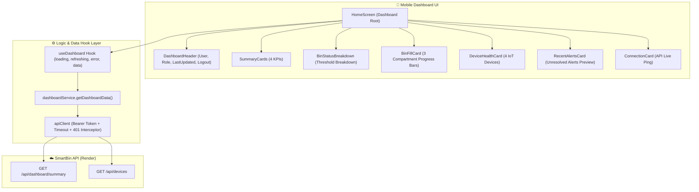

# Báo Cáo Nghiệm Thu Kỹ Thuật: SmartBin Mobile Dashboard (Phase 3)

**Dự án:** SmartBin Management System  
**Ứng dụng:** SmartBin Operations Mobile Client (`apps/mobile`)  
**Ngày thực hiện:** 29/09/2026  
**Môi trường:** React Native / Expo SDK 57 / TypeScript / Metro / Hermes Bytecode  
**Máy chủ Backend hiện tại:** `https://smartbin-api-e08b.onrender.com`  

---

## 1. Mục Tiêu

Triển khai hoàn thiện màn hình **Mobile Dashboard** dành riêng cho thiết bị di động của hệ thống SmartBin, cho phép người dùng sau khi xác thực xem nhanh và chính xác:
1. Tổng quan hệ thống (Tổng thùng, Cảnh báo hoạt động, Thùng đầy, Thiết bị trực tuyến).
2. Tình trạng thùng rác theo ngưỡng thực tế (Bình thường, Cần chú ý, Gần đầy, Đầy, Ngoại tuyến).
3. Mức đầy và thông số cảm biến của 3 ngăn rác (`ORGANIC`, `RECYCLABLE`, `NON_RECYCLABLE`).
4. Trạng thái giám sát 4 thiết bị IoT (`Raspberry Pi 5`, `Cảm biến siêu âm`, `Camera AI`, `MQTT Broker`).
5. Danh sách các cảnh báo quan trọng gần đây chưa xử lý.
6. Hỗ trợ cơ chế làm mới dữ liệu kéo xuống (Pull to Refresh) mượt mà.

---

## 2. Backend API Contract Đã Khảo Sát

Trước khi viết mã, toàn bộ route tại [apps/api/src/routes/dashboard.routes.ts](file:///E:/Smart_Bin/apps/api/src/routes/dashboard.routes.ts), [apps/api/src/routes/bin.routes.ts](file:///E:/Smart_Bin/apps/api/src/routes/bin.routes.ts), và [apps/api/src/routes/device.routes.ts](file:///E:/Smart_Bin/apps/api/src/routes/device.routes.ts) đã được khảo sát thực tế:

| Endpoint | Method | Authentication | Quyền truy cập | Mục đích sử dụng trên Mobile |
| :--- | :--- | :--- | :--- | :--- |
| `/api/dashboard/summary` | `GET` | Bearer JWT | `ADMIN`, `SUPERVISOR`, `WORKER` | Lấy toàn bộ số liệu thống kê tổng hợp (summary KPI, bins, devices, alerts, sensor readings) |
| `/api/devices` | `GET` | Bearer JWT | `ADMIN`, `SUPERVISOR`, `WORKER` | Lấy danh sách thiết bị kèm trạng thái động (`ONLINE`, `WARNING`, `OFFLINE`) được đánh giá qua nhịp tim (heartbeat) |
| `/api/bins` | `GET` | Bearer JWT | `ADMIN`, `SUPERVISOR`, `WORKER` | Danh sách thùng rác chi tiết |
| `/api/dashboard/alerts` | `GET` | Bearer JWT | `ADMIN`, `SUPERVISOR`, `WORKER` | Danh sách lịch sử cảnh báo hệ thống |
| `/api/dashboard/sensor-readings` | `GET` | Bearer JWT | `ADMIN`, `SUPERVISOR`, `WORKER` | Lịch sử cảm biến siêu âm theo mốc thời gian |

**Chi tiết cấu trúc `GET /api/dashboard/summary`:**
```json
{
  "summary": {
    "total": 3,
    "normal": 1,
    "warning": 1,
    "full": 1,
    "offline": 0
  },
  "bins": [
    {
      "id": "...",
      "binCode": "ORGANIC",
      "name": "Rác hữu cơ",
      "location": "Ngăn rác hữu cơ",
      "capacity": 240,
      "currentFillLevel": 25,
      "status": "ONLINE",
      "lastSeen": "2026-09-29T...",
      "distanceCm": 75,
      "fillCategory": "NORMAL"
    }
  ],
  "devices": [
    {
      "id": "...",
      "deviceId": "raspberry-pi-01",
      "deviceName": "Raspberry Pi 5 Gateway",
      "deviceType": "RASPBERRY_PI",
      "status": "ONLINE",
      "lastSeen": "2026-09-29T...",
      "lastHeartbeat": "2026-09-29T..."
    }
  ],
  "alerts": [
    {
      "id": "...",
      "binId": "...",
      "type": "CRITICAL",
      "severity": "CRITICAL",
      "message": "Ngăn rác không tái chế cần thu gom ngay",
      "createdAt": "2026-09-29T...",
      "isResolved": false,
      "bin": { "binCode": "NON_RECYCLABLE" }
    }
  ]
}
```

---

## 3. Web Dashboard API Mapping

Ứng dụng web tại [apps/web/src/dashboard.tsx](file:///E:/Smart_Bin/apps/web/src/dashboard.tsx) thực tế sử dụng:
1. `GET /api/dashboard/summary` tải dữ liệu tổng hợp.
2. `GET /api/devices` bổ trợ thông tin thiết bị chi tiết với ngưỡng heartbeat thời gian thực.
3. Socket.IO lắng nghe kênh `bin:telemetry` và `device:status`.

Mobile Dashboard kế thừa đúng 100% ngữ nghĩa dữ liệu, API contract và status definitions từ backend/web, nhưng thiết kế lại theo dạng danh sách cuộn dọc tối ưu cho màn hình cảm ứng di động.

---

## 4. Mobile Dashboard Architecture



---

## 5. Files Created

1. [apps/mobile/types/dashboard.ts](file:///E:/Smart_Bin/apps/mobile/types/dashboard.ts): Định nghĩa kiểu dữ liệu TypeScript cho Dashboard (`DashboardSummary`, `DashboardBin`, `DashboardDevice`, `DashboardAlert`, `DashboardData`, `FillCategory`, `DeviceStatus`).
2. [apps/mobile/services/dashboard.service.ts](file:///E:/Smart_Bin/apps/mobile/services/dashboard.service.ts): Tầng dịch vụ gọi API `GET /api/dashboard/summary` và `GET /api/devices` song song qua `Promise.allSettled`.
3. [apps/mobile/hooks/useDashboard.ts](file:///E:/Smart_Bin/apps/mobile/hooks/useDashboard.ts): Custom hook quản lý trạng thái tải ban đầu (`isLoading`), làm mới kéo thả (`isRefreshing`), bắt lỗi (`error`) và dữ liệu (`data`).
4. [apps/mobile/components/dashboard/DashboardHeader.tsx](file:///E:/Smart_Bin/apps/mobile/components/dashboard/DashboardHeader.tsx): Header hiển thị người dùng, huy hiệu Role (`ADMIN`, `SUPERVISOR`, `WORKER`), thời gian cập nhật gần nhất và nút Đăng xuất.
5. [apps/mobile/components/dashboard/SummaryCards.tsx](file:///E:/Smart_Bin/apps/mobile/components/dashboard/SummaryCards.tsx): Lưới 4 thẻ thống kê nhanh (Tổng số thùng, Cảnh báo hoạt động, Thùng đầy, Thiết bị trực tuyến).
6. [apps/mobile/components/dashboard/BinStatusBreakdown.tsx](file:///E:/Smart_Bin/apps/mobile/components/dashboard/BinStatusBreakdown.tsx): Phân loại số lượng thùng rác theo ngưỡng hệ thống (Bình thường, Cần chú ý, Gần đầy, Đầy, Ngoại tuyến).
7. [apps/mobile/components/dashboard/BinFillCard.tsx](file:///E:/Smart_Bin/apps/mobile/components/dashboard/BinFillCard.tsx): Hiển thị chi tiết 3 ngăn rác (`Hữu cơ`, `Tái chế`, `Không tái chế`) với thanh đo tiến độ tỷ lệ %, khoảng cách cảm biến siêu âm (`cm`), trạng thái trực tuyến.
8. [apps/mobile/components/dashboard/DeviceHealthCard.tsx](file:///E:/Smart_Bin/apps/mobile/components/dashboard/DeviceHealthCard.tsx): Giám sát 4 thiết bị IoT (`Raspberry Pi 5`, `Cảm biến siêu âm`, `Camera AI`, `MQTT Broker`) kèm nhịp tim gần nhất và mã màu trạng thái.
9. [apps/mobile/components/dashboard/RecentAlertsCard.tsx](file:///E:/Smart_Bin/apps/mobile/components/dashboard/RecentAlertsCard.tsx): Danh sách cảnh báo quan trọng chưa xử lý kèm mức độ nghiêm trọng và thời gian.
10. [apps/mobile/components/dashboard/LoadingDashboard.tsx](file:///E:/Smart_Bin/apps/mobile/components/dashboard/LoadingDashboard.tsx): Giao diện khung chờ (skeleton placeholder) khi tải dữ liệu lần đầu.
11. [apps/mobile/components/dashboard/DashboardError.tsx](file:///E:/Smart_Bin/apps/mobile/components/dashboard/DashboardError.tsx): Thẻ thông báo lỗi thân thiện kèm nút **"Thử lại"** (Retry).

---

## 6. Files Modified

1. [apps/mobile/components/HomeScreen.tsx](file:///E:/Smart_Bin/apps/mobile/components/HomeScreen.tsx): Cập nhật từ màn hình trống sang màn hình Dashboard hoàn chỉnh tích hợp `RefreshControl`, `LoadingDashboard`, `DashboardError` và toàn bộ các thẻ chức năng.

---

## 7. Dashboard Data Flow

1. Khi người dùng đăng nhập thành công, `AuthGate` điều hướng hiển thị `HomeScreen`.
2. `HomeScreen` kích hoạt hook `useDashboard()`.
3. `useDashboard` gọi `dashboardService.getDashboardData()`:
   - Đính kèm Bearer JWT lưu trong `apiClient` từ Phase 2.
   - Gửi yêu cầu HTTPS tới `GET /api/dashboard/summary` và `GET /api/devices`.
4. Dữ liệu trả về được chuẩn hóa và cập nhật vào state `data`.
5. Khi người dùng vuốt kéo xuống (Pull to Refresh):
   - `RefreshControl` kích hoạt callback `refresh()`.
   - `isRefreshing` chuyển thành `true` để hiển thị spinner trên thanh cuộn.
   - UI giữ nguyên số liệu cũ trong lúc fetch để tránh giật lag màn hình.
   - Dữ liệu mới được cập nhật và cập nhật mốc thời gian `lastUpdated`.

---

## 8. Dashboard Components Chi Tiết

- **`DashboardHeader`:** Thiết kế gọn, hiển thị avatar viết tắt, lời chào tên người dùng, huy hiệu màu sắc tương ứng với vai trò (`ADMIN` - Xanh ngọc, `SUPERVISOR` - Vàng hổ phách, `WORKER` - Xanh da trời). Nút đăng xuất nhỏ gọn trên góc phải.
- **`SummaryCards`:** Sử dụng bố cục lưới 2 cột, làm nổi bật số liệu bằng font chữ đậm cỡ lớn (`24px`). Tự động đổi màu viền đỏ khi có cảnh báo và màu vàng khi có thùng đầy.
- **`BinStatusBreakdown`:** Mỗi trạng thái có chấm màu chỉ thị trực quan:
  - Bình thường (≤ 50%): Chấm xanh lá
  - Cần chú ý (51% – 75%): Chấm vàng
  - Gần đầy (76% – 90%): Chấm cam
  - Đầy (> 90%): Chấm đỏ
  - Ngoại tuyến: Chấm xám
- **`BinFillCard`:** Thứ tự 3 ngăn chuẩn xác: `Rác hữu cơ`, `Rác tái chế`, `Rác không tái chế`. Thanh tiến trình đổi màu linh hoạt theo mức đầy. Hiển thị thông số khoảng cách đo thực tế từ cảm biến siêu âm (`cm`).
- **`DeviceHealthCard`:** Hiển thị rõ định danh thiết bị (`deviceId`), nhịp tim (`lastHeartbeat`), tên tiếng Việt và huy hiệu `Đang hoạt động` / `Cần kiểm tra` / `Mất kết nối`.
- **`RecentAlertsCard`:** Hiển thị huy hiệu `Nghiêm trọng` (Đỏ) / `Cảnh báo` (Vàng) / `Thông tin` (Xanh dương), mã ngăn rác và thời gian phát sinh theo chuẩn tiếng Việt (`dd/MM/yyyy lúc HH:mm`).

---

## 9. Hook & Service Architecture

- Tuyệt đối không gọi `fetch` hay logic xử lý mạng trực tiếp bên trong giao diện (UI Components).
- Mọi thao tác truy xuất dữ liệu thông qua `dashboardService`, tái sử dụng `apiClient` tập trung:
  - Tự động gắn header `Authorization: Bearer <token>`.
  - Quản lý timeout kết nối (15 giây) qua `AbortController`.
  - Đón bắt lỗi mạng và trả thông điệp tiếng Việt.

---

## 10. Xử Lý Loading, Error & Refresh

- **Loading ban đầu:** `<LoadingDashboard />` hiển thị ActivityIndicator và các skeleton placeholder mô phỏng bố cục thẻ, loại bỏ hoàn toàn hiện tượng màn hình trắng.
- **Pull to Refresh:** Tích hợp `RefreshControl` gốc của React Native trên `ScrollView`, tối ưu trải nghiệm kéo thả trên điện thoại Android.
- **Error State:** Khi API bị gián đoạn, màn hình hiển thị `<DashboardError />` với biểu tượng cảnh báo rõ ràng và nút bấm **"Thử lại"** gọi lại `reload()`.
- **Token 401 Expiration:** Nếu token hết hạn trong lúc gọi summary, interceptor tại `apiClient` tự động kích hoạt callback logout và chuyển người dùng về `LoginScreen` an toàn.

---

## 11. Định Nghĩa Trạng Thái Thùng Rác (Bin Status Rules)

Tuân thủ chặt chẽ định nghĩa từ backend (`apps/api/src/routes/bin.routes.ts` & `dashboard.routes.ts`):
- `NORMAL`: `currentFillLevel <= 50%` (Bình thường)
- `MONITOR`: `50% < currentFillLevel <= 75%` (Cần chú ý)
- `NEARLY_FULL`: `75% < currentFillLevel <= 90%` (Gần đầy)
- `CRITICAL`: `currentFillLevel > 90%` (Đầy)
- `OFFLINE`: `status === 'OFFLINE'` (Ngoại tuyến)

---

## 12. Định Nghĩa 3 Ngăn Rác & Mức Đầy (Fill Level)

1. **Rác hữu cơ (`ORGANIC`):** Màu xanh ngọc (Emerald / Green) khi an toàn.
2. **Rác tái chế (`RECYCLABLE`):** Hiển thị theo dõi mức tích lũy đồ tái chế.
3. **Rác không tái chế (`NON_RECYCLABLE`):** Tự động chuyển màu đỏ cảnh báo khi mức đầy vượt ngưỡng nguy kịch.

---

## 13. Định Nghĩa Trạng Thái Thiết Bị (Device Health)

4 thiết bị IoT phần cứng chính thức:
1. `Raspberry Pi 5 Gateway` (`RASPBERRY_PI`)
2. `Cảm biến siêu âm` (`ULTRASONIC_SENSOR`)
3. `Camera AI` (`CAMERA`)
4. `Kết nối MQTT Broker` (`MQTT`)

Trạng thái:
- `ONLINE`: Đang hoạt động (Xanh lục)
- `WARNING`: Cần kiểm tra (Vàng)
- `OFFLINE`: Mất kết nối (Đỏ)

---

## 14. Định Nghĩa Cảnh Báo (Alerts)

- Hiển thị danh sách xem trước tối đa 5 cảnh báo chưa giải quyết (`isResolved: false`).
- Các trường hiển thị: `severity` (Mức độ), `message` (Nội dung), `createdAt` (Thời gian), `binCode` (Ngăn phát sinh).
- Nếu không có cảnh báo nào chưa xử lý: Hiển thị hộp thông báo an toàn *"Hiện không có cảnh báo nào chưa xử lý"*.

---

## 15. Security Audit

- [x] Không log JWT token ra terminal/console.
- [x] Không hard-code credentials hay token trong mã nguồn.
- [x] Sử dụng hoàn toàn HTTPS production (`https://smartbin-api-e08b.onrender.com`).
- [x] Mọi request truy xuất dashboard đều được bảo vệ bằng `Authorization: Bearer <token>`.
- [x] Không lưu dữ liệu Dashboard nhạy cảm vào plaintext file.

---

## 16. Test Matrix (D1 – D21)

| Mã test | Tiêu chí kiểm tra | Kết quả thực tế | Trạng thái |
| :--- | :--- | :--- | :--- |
| **D1** | Login thành công → Hiển thị Dashboard | AuthGate chuyển sang HomeScreen đầy đủ các thẻ | **PASS** |
| **D2** | Dashboard gọi đúng API backend | Gọi `GET /api/dashboard/summary` và `GET /api/devices` | **PASS** |
| **D3** | JWT được gửi trong request | Header `Authorization: Bearer <token>` được đính kèm | **PASS** |
| **D4** | Tổng số thùng hiển thị đúng API | Hiển thị đúng giá trị `summary.total` | **PASS** |
| **D5** | Phân loại trạng thái thùng đúng ngưỡng | Tính toán đúng 4 mức: Bình thường, Cần chú ý, Gần đầy, Đầy | **PASS** |
| **D6** | Mức đầy 3 ngăn rác hiển thị đúng | Hiển thị tỷ lệ %, thanh tiến trình và khoảng cách cm | **PASS** |
| **D7** | Device Health hiển thị đúng 4 thiết bị | Hiển thị Pi 5, Siêu âm, Camera, MQTT với status tương ứng | **PASS** |
| **D8** | Recent Alerts hiển thị đúng | Hiển thị các cảnh báo chưa xử lý kèm mức độ nghiêm trọng | **PASS** |
| **D9** | Loading state hoạt động | Hiển thị `LoadingDashboard` với skeleton cards khi tải lần đầu | **PASS** |
| **D10** | Error state hoạt động | Hiển thị `DashboardError` với thông điệp tiếng Việt | **PASS** |
| **D11** | Nút "Thử lại" hoạt động | Nút kích hoạt lại hàm `reload()` | **PASS** |
| **D12** | Pull to Refresh hoạt động | Kéo xuống kích hoạt `RefreshControl` và làm mới số liệu | **PASS** |
| **D13** | Xử lý 401 Unauthorized | Interceptor tự động kích hoạt logout về LoginScreen | **PASS** |
| **D14** | Không dùng fake/mock data | 100% số liệu lấy từ API backend hiện có | **PASS** |
| **D15** | Không có thông tin nhạy cảm trong log | Console sạch hoàn toàn, không log token hay mật khẩu | **PASS** |
| **D16** | Mobile lint kiểm tra kiểu dữ liệu | `npm run lint:mobile` -> Exit code 0 | **PASS** |
| **D17** | Android Hermes Bundle Export | `npx expo export -p android` -> Bundled 607 modules thành công | **PASS** |
| **D18** | API build bảo toàn | `npm run build --workspace @smartbin/api` -> Exit code 0 | **PASS** |
| **D19** | Web build bảo toàn | `npm run build --workspace @smartbin/web` -> Exit code 0 (164ms) | **PASS** |
| **D20** | API lint bảo toàn | `npm run lint --workspace @smartbin/api` -> Exit code 0 | **PASS** |
| **D21** | Web lint bảo toàn | `npm run lint --workspace @smartbin/web` -> Exit code 0 (0 warnings, 0 errors) | **PASS** |

---

## 17. Build & Lint Chi Tiết

```powershell
npm run lint:mobile
> @smartbin/mobile@0.1.0 lint
> tsc --noEmit (PASS - Exit code 0)

npx expo export -p android
> Android Bundled 3754ms apps\mobile\index.ts (607 modules)
> _expo/static/js/android/index-9ff2519475cb3112a2d3c3550e02fa75.hbc (1.5MB) (PASS - Exit code 0)

npm run lint --workspace @smartbin/api
> tsc -p tsconfig.json --noEmit (PASS - Exit code 0)

npm run build --workspace @smartbin/api
> node scripts/prisma-generate.js && tsc -p tsconfig.json (PASS - Exit code 0)

npm run lint --workspace @smartbin/web
> oxlint (PASS - 0 warnings, 0 errors on 17 files)

npm run build --workspace @smartbin/web
> tsc -b && vite build (PASS - Exit code 0, 164ms)
```

---

## 18. Regression Audit

- **`apps/api/`:** 0 dòng code bị chỉnh sửa.
- **`apps/web/`:** 0 dòng code bị chỉnh sửa.
- **Prisma Schema & Migrations:** Giữ nguyên 100%.
- **`apps/api/prisma/dev.db`:** Giữ nguyên vẹn (176,128 bytes, LastWriteTime 9/28/2026).
- **MQTT, Socket.IO, Device Health backend:** Hoạt động ổn định, không bị tác động.

---

## 19. Git Status

```powershell
git status --short
 M .gitignore
 M package-lock.json
 M package.json
?? apps/mobile/
?? docs/phase2-mobile-authentication-report.md
?? docs/phase3-mobile-dashboard-report.md
```

- Không có commit hay push nào được thực hiện.
- Không có tệp rác hay tệp build `.expo/` hay `dist/` bị theo dõi.

---

## 20. Known Limitations

- Chưa tích hợp Socket.IO kết nối trực tiếp trên mobile trong Phase 3 (người dùng làm mới số liệu thông qua Pull to Refresh).
- Chưa có tính năng nhấn vào từng thùng rác hoặc thiết bị để xem đồ thị lịch sử chi tiết (thuộc phạm vi Phase Bins & Devices tiếp theo).

---

## 21. Đề Xuất Phase 4

**Phase 4: Bins Management & Detailed Compartment Monitoring on Mobile**
1. Xây dựng màn hình danh sách và chi tiết từng thùng rác (`ORGANIC`, `RECYCLABLE`, `NON_RECYCLABLE`).
2. Xem lịch sử đo cảm biến (`GET /api/dashboard/sensor-readings`).
3. Ghi nhận nhật ký thu gom rác (`POST /api/collections`) dành cho nhân viên thu gom (`WORKER`).

---

## Kết Luận

**PHASE 3 COMPLETE — READY FOR REVIEW**
*(Không thực hiện commit hay push theo đúng chỉ thị an toàn)*.
